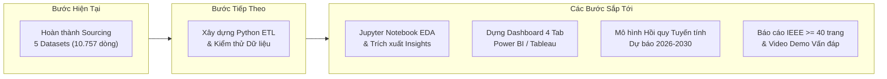

# Global Gaming Market Revenue & Platform Battle: PC vs Console vs Mobile
> **Nghiên cứu & Phân tích Doanh số Toàn cầu và Sự Cạnh tranh Nền tảng: PC vs Console vs Mobile (1971 – 2025)**  
> *Đồ án Môn học: Tương tác Dữ liệu Trực quan (Interactive Data Visualization)*

---

## Trạng Thái Tiến Độ Dự Án (Project Progress)

> **Cột mốc hiện tại (Current Milestone):**  
> **GIAI ĐOẠN 1: Thu thập, Khảo sát & Đặc tả 5 Tập Dữ liệu Hoàn tất (10.757 bản ghi)**  
> *(Các giai đoạn tiếp theo sẽ được cập nhật liên tục theo tiến độ thực hiện đồ án)*

```
[Bước 1: Xác định Đề tài & Thu thập Dataset (Hoàn thành)]
                         │
                         ▼
[Bước 2: Tiền xử lý Dữ liệu & Chuẩn hóa Đa chiều (ETL Pipeline)]
                         │
                         ▼
[Bước 3: Phân tích Khám phá Dữ liệu (Exploratory Data Analysis - EDA)]
                         │
                         ▼
[Bước 4: Xây dựng Dashboard Tương tác (Power BI / Tableau)]
                         │
                         ▼
[Bước 5: Mô hình Hồi quy Tuyến tính Dự báo Thị trường đến 2030]
                         │
                         ▼
[Bước 6: Hoàn thiện Báo cáo IEEE & Video Demo Vấn đáp]
```

---

## Thể Loại & Định Vị Dự Án (Project Type Flags)

- [x] **Thu thập & Tích hợp Dữ liệu Đa nguồn (Multi-Source Data Sourcing)**
- [x] **Đặc tả Từ điển Dữ liệu (Data Dictionary & Metadata Profiling)**
- [x] Tiền xử lý & Chuẩn hóa Chỉ số (Data Cleaning & Harmonization ETL)
- [x] Phân tích Khám phá Dữ liệu (Exploratory Data Analysis - EDA)
- [ ] Thiết kế Dashboard Trực quan Tương tác (Interactive BI Dashboard)
- [ ] Dự báo Chuỗi thời gian (Linear Regression Forecasting 2026–2030)
- [ ] Báo cáo Nghiên cứu Chuẩn IEEE (Final Academic Report)

---

## Mục Lục (Table of Contents)

1. [Tổng Quan Đề Tài (Project Overview)](#1-tổng-quan-đề-tài-project-overview)
2. [Câu Hỏi Nghiên Cứu & Mục Tiêu (Research Questions & Objectives)](#2-câu-hỏi-nghiên-cứu--mục-tiêu-research-questions--objectives)
3. [Phạm Vi & Công Cụ Nghiên Cứu (Scope & Tools)](#3-phạm-vi--công-cụ-nghiên-cứu-scope--tools)
4. [Cấu Trúc Thư Mục Repository (Repository Structure)](#4-cấu-trúc-thư-mục-repository-repository-structure)
5. [Dữ Liệu Đầu Vào & Từ Điển Dữ Liệu (Datasets & Data Dictionary)](#5-dữ-liệu-đầu-vào--từ-điển-dữ-liệu-datasets--data-dictionary)
6. [Kế Hoạch Chuẩn Hóa Chỉ Số Dự Kiến (Planned Harmonization Strategy)](#6-kế-hoạch-chuẩn-hóa-chỉ-số-dự-kiến-planned-harmonization-strategy)
7. [Kế Hoạch Thực Hiện & Phân Công Nhóm (Roadmap & Team Allocation)](#7-kế-hoạch-thực-hiện--phân-công-nhóm-roadmap--team-allocation)

---

## 1. Tổng Quan Đề Tài (Project Overview)

* **Bối cảnh ngành:** Ngành công nghiệp game toàn cầu là lĩnh vực giải trí kỹ thuật số có tốc độ tăng trưởng phi mã và thị phần chuyển dịch mạnh mẽ nhất trong 4 thập kỷ qua (1971 – 2025). Sự tương quan sức mạnh giữa 3 nền tảng trụ cột — **PC (Steam/Độc lập), Console (PlayStation/Xbox/Nintendo) và Mobile (Android/iOS Free-to-Play)** — đã định hình lại hành vi tiêu dùng và cấu trúc tài chính toàn cầu.
* **Vấn đề giải quyết (Problem Statement):** Dữ liệu ngành game bị phân mảnh trầm trọng do sự khác biệt về bản chất kinh doanh: Console đo lường bằng số triệu đĩa xuất xưởng (`Total Shipped`), PC đo lường bằng dải tài khoản sở hữu (`owners`) và tỷ lệ đánh giá cộng đồng, trong khi Mobile vận hành theo lượt tải (`realInstalls`) và kiếm tiền qua In-App Purchases (IAP). Chưa có một hệ thống trực quan hóa nào dung hòa đồng thời cả 3 nền tảng trên cùng một quy chuẩn đối chiếu khách quan.
* **Cách tiếp cận (Approach):** Thu thập và tích hợp **5 tập dữ liệu bổ trợ** (gồm 3 tập vi mô đại diện 3 nền tảng và 2 tập vĩ mô chuẩn quốc tế), xây dựng cơ chế **Chuẩn hóa Chỉ số Đa chiều (Dual-Metric Harmonization)** để quy đổi song song về:
  1. *Doanh số về Lượng* (Volume / Audience Reach)
  2. *Doanh số về Giá trị Tiền tệ* (Estimated USD Revenue)
  3. *Chất lượng Sản phẩm Chuẩn hóa* (`Standardized_Rating` thang 0–100)
* **Kết quả giai đoạn hiện tại:** Đã hoàn thành toàn bộ khâu tìm kiếm, thu thập qua API/Scraper và lập tài liệu metadata chi tiết cho **10.757 bản ghi**, sẵn sàng đưa vào pipeline xử lý dữ liệu.

---

## 2. Câu Hỏi Nghiên Cứu & Mục Tiêu (Research Questions & Objectives)

### 5 Câu Hỏi Nghiên Cứu Cốt Lõi (Core Research Questions)

1. **RQ1 (Sự Dịch chuyển Thị phần - Macro Market Shift):** Cơ cấu thị phần doanh số và quy mô doanh thu toàn cầu giữa PC, Console và Mobile đã biến đổi như thế nào từ 1980 đến 2025 dưới tác động của các cột mốc công nghệ (Console Next-Gen, Kỷ nguyên Smartphone bùng nổ, Đại dịch COVID-19)?
2. **RQ2 (Chiến địa Thể loại - Genre Battlefield):** Nền tảng nào nắm giữ vị thế "thống trị độc tôn" ở từng thể loại game cụ thể? Thể loại nào là chiến trường cạnh tranh gay gắt nhất giữa cả 3 bên?
3. **RQ3 (Nghịch lý Chất lượng, Quy mô & Doanh thu - The Quality-Reach Paradox):** Mối quan hệ giữa Điểm đánh giá chất lượng (`Standardized_Rating`) và Thành công thương mại (Sales/Revenue) diễn biến ra sao giữa các hệ máy giá cao (\$70/game) và nền tảng di động miễn phí (F2P/IAP)?
4. **RQ4 (Sức mạnh của Game Đa Nền tảng - Cross-Platform Power):** Các tựa game phát hành đa nền tảng (`Is_CrossPlatform = True`) có mang lại doanh số, lượt tiếp cận và vòng đời vượt trội hơn so với các tựa game độc quyền (`Exclusive`) hay không?
5. **RQ5 (Dự phóng Thị trường đến 2030 - Market Projection):** Mô hình Hồi quy Tuyến tính (Linear Regression) dự báo doanh thu và sự dịch chuyển thị phần của 3 nền tảng sẽ diễn tiến ra sao trong giai đoạn 2026 – 2030?

---

## 3. Phạm Vi & Công Cụ Nghiên Cứu (Scope & Tools)

### Phạm vi Nghiên cứu (Scope Definition)

| Chiều phân tích | Chi tiết trong phạm vi (In Scope) | Ngoài phạm vi (Out of Scope) |
|---|---|---|
| **Nền tảng** | PC (Steam Ecosystem), Console (PlayStation, Xbox, Nintendo, v.v.), Mobile (Android / Google Play) | Các nền tảng Arcade thùng cổ điển, Cloud Gaming độc lập (GeForce Now, Luna) |
| **Thời gian** | Dữ liệu lịch sử từ 1971 – 2025; Chuỗi dữ liệu địa lý 2021 – 2025 | Dữ liệu giao dịch nội bộ từng giờ/từng ngày của các hãng |
| **Quy mô dữ liệu** | **10.757 bản ghi** từ 5 tập dữ liệu | Dữ liệu phần cứng máy tính cá nhân chi tiết (GPU/CPU specs) |
| **Đơn vị phân tích** | Cấp độ tựa game (`Game_Title`), cấp độ thể loại (`Genre`), cấp độ khu vực địa lý (`Region`) | Phân tích cảm xúc từng dòng bình luận người dùng (Sentiment text mining) |

### Công Cụ & Công Nghệ Sử Dụng (Tools & Technologies)

* **Ngôn ngữ lập trình:** Python 3.11+
* **Thư viện Thu thập & Xử lý:** Requests, Beautiful Soup, Google Play Scraper, Pandas, NumPy
* **Môi trường Phân tích & EDA:** Jupyter Notebook (`notebooks/`)
* **Nền tảng Trực quan hóa Tương tác (Upcoming):** Power BI / Tableau Desktop
* **Mô hình Dự báo (Upcoming):** Scikit-Learn (Linear Regression), SciPy, Statsmodels
* **Quản trị Phiên bản & Tài liệu:** Git, GitHub, Markdown (IEEE Academic Formatting)

---

## 4. Cấu Trúc Thư Mục Repository (Repository Structure)

```
Gaming-Market-Industry-Analytics/
│
├── data/
│   ├── raw/                  # Dữ liệu gốc thu thập từ nguồn - không chỉnh sửa thủ công
│   ├── processed/            # Dữ liệu sau khi làm sạch và tích hợp chuẩn hóa
│   └── external/             # Dữ liệu đối sánh vĩ mô bổ trợ (báo cáo Sensor Tower, Newzoo)
│
├── docs/                     # Tài liệu nghiên cứu, Data Dictionary, Kế hoạch đồ án
│   ├── project_overview.md   # Thuyết minh chi tiết tổng quan đề tài
│   ├── data_dictionary.md    # Đặc tả chi tiết từng trường dữ liệu & tỷ lệ missing
│   ├── project_master_plan.md# Kế hoạch chi tiết phân kỳ đồ án
│   └── team_work_allocation.md# Bản phân chia công việc 3 thành viên
│
├── notebooks/                # Jupyter Notebooks phục vụ ETL, EDA và thử nghiệm mô hình
│   ├── etl/                  # Pipeline tiền xử lý & làm sạch dữ liệu các nền tảng
│   │   ├── 01_etl_pc.ipynb
│   │   ├── 02_etl_console.ipynb
│   │   ├── 03_etl_mobile.ipynb
│   │   └── 04_etl_master_pipeline.ipynb
│   ├── 01_eda_exploration.ipynb
│   └── 02_predictive_modeling.ipynb
│
├── scripts/                  # Kịch bản Python tự động hóa & kiểm thử
│   └── validate_data.py
│
├── dashboard/                # File thiết kế Dashboard tương tác (Power BI / Tableau)
│   └── powerbi/
│
├── visuals/                  # Biểu đồ tĩnh trích xuất, ảnh chụp Dashboard
│   ├── dashboard_screenshots/
│   └── eda_static/
│
├── reports/                  # Báo cáo học thuật chuẩn IEEE, Slide thuyết trình
│   ├── ieee_report/
│   ├── presentation/
│   └── video_demo/
│
└── README.md                 # Tài liệu trung tâm của dự án (Bạn đang ở đây)
```

---

## 5. Dữ Liệu Đầu Vào & Từ Điển Dữ Liệu (Datasets & Data Dictionary)

Dự án đã hoàn tất việc khảo sát và thu thập **5 tập dữ liệu** với tổng cộng **10.757 dòng**, bao quát trọn vẹn cả 3 nền tảng chính cùng các mốc quy chuẩn vĩ mô:

### 5.1. Bảng Tổng Quan 5 Tập Dữ Liệu

| STT | Tập Dữ Liệu (`Filename`) | Nền tảng Đại diện | Nguồn Thu Thập (`Source`) | Số Dòng | Số Cột | Vai Trò Phân Tích |
|:---:|---|---|---|:---:|:---:|---|
| **1** | `vgchartz_games.csv` | **Console & History** | VGChartz Global Database Crawler | **4.000** | **19** | Phân tích 4 thập kỷ game console, doanh số bán đĩa vật lý và điểm phê bình. |
| **2** | `steamspy_games_4000.csv` | **PC Gaming** | SteamSpy API & Steam Metadata | **4.000** | **23** | Khảo sát hệ sinh thái Steam, giá bán, thời gian chơi và đánh giá cộng đồng. |
| **3** | `mobile_playstore_games_2000+.csv` | **Mobile Gaming** | Google Play Store Scraper API | **2.720** | **23** | Đo lường độ phủ người dùng qua lượt tải thực tế và mô hình F2P / IAP. |
| **4** | `genre_revenue_2024_2025.csv` | **Macro Genre Benchmark** | Báo cáo Sensor Tower & Steam Reports | **12** | **5** | Khung doanh thu chuẩn vĩ mô theo 12 thể loại dùng để hiệu chỉnh ARPU Mobile. |
| **5** | `revenue_by_region(2021 - 2025).csv` | **Geographic Market Share**| Newzoo Global Games Market Reports | **25** | **5** | Chuỗi dữ liệu thị phần & tăng trưởng theo 5 vùng lãnh thổ phục vụ Bản đồ Địa lý. |

---

### 5.2. Đặc Tả Schema & Các Trường Cốt Lõi (Raw Schema Summary)

#### Tập 1: Console Dataset (`vgchartz_games.csv` - 4.000 dòng, 19 cột)
* **Khóa chính:** `Pos` (Hạng phân phối) + `Game` (Tên game) + `Platform` (Hệ máy)
* **Các trường dữ liệu quan trọng:**
  * `Game`: Tên tựa trò chơi (chuỗi ký tự).
  * `Platform`: Hệ máy phát hành (37 hệ máy: PS2, PS4, PS5, X360, NS, Wii, v.v.).
  * `Genre`: Thể loại game (Action, Shooter, Role-Playing, Sports,...).
  * `Publisher` & `Developer`: Đơn vị phát hành thương mại và Studio phát triển.
  * `Total Shipped`: **Chỉ số lượng cốt lõi** (triệu bản đĩa xuất xưởng, ví dụ `"520.00m"`).
  * `Critic Score` & `User Score`: Điểm đánh giá của giới phê bình và game thủ (thang 10).
  * `Release Year`: Năm phát hành (1971 – 2025).

#### Tập 2: PC Steam Dataset (`steamspy_games_4000.csv` - 4.000 dòng, 23 cột)
* **Khóa chính:** `appid` (Định danh duy nhất trên Steam)
* **Các trường dữ liệu quan trọng:**
  * `name`: Tên thương mại tựa game trên Steam.
  * `genre` & `tags`: Thể loại chính và hệ thống thẻ tag do cộng đồng bình chọn.
  * `owners`: **Chỉ số lượng cốt lõi** dạng dải ước tính (ví dụ: `"10,000,000 .. 20,000,000"`).
  * `price` & `initialprice`: Giá hiện tại và giá gốc tính bằng cents USD (cần chia 100).
  * `discount`: Tỷ lệ phần trăm giảm giá.
  * `positive` & `negative`: Lượng bình chọn tích cực (Upvote) và tiêu cực (Downvote).
  * `ccu`: Lượng người chơi đồng thời cao nhất (Peak Concurrent Users).
  * `average_forever` & `median_forever`: Thời gian chơi trung bình và trung vị trọn đời (phút).

#### Tập 3: Mobile Google Play Dataset (`mobile_playstore_games_2000+.csv` - 2.720 dòng, 23 cột)
* **Khóa chính:** `app_id` (Định danh package ứng dụng Android)
* **Các trường dữ liệu quan trọng:**
  * `title`: Tên tựa game di động.
  * `genre`: Thể loại trò chơi theo Google Play.
  * `realInstalls`: **Chỉ số lượng cốt lõi** ước tính chính xác lượt cài đặt thực tế.
  * `score`: Điểm đánh giá sao của người dùng (thang điểm 5.0).
  * `ratings` & `reviews`: Tổng số lượt chấm điểm sao và số lượt nhận xét văn bản.
  * `price_usd` & `is_free`: Giá tải ban đầu và cờ xác định tải miễn phí.
  * `offersIAP`: Cờ xác định trò chơi có tính năng In-App Purchases (nạp tiền trong game).

#### Tập 4 & 5: Dữ Liệu Chuẩn Vĩ Mô (Benchmarks & Geography)
* `genre_revenue_2024_2025.csv`: Doanh thu toàn cầu (tỷ USD) của 12 thể loại game chính (Action, RPG, Strategy, Casual,...).
* `revenue_by_region(2021 - 2025).csv`: Doanh thu, tỷ trọng (%) và tốc độ tăng trưởng YoY của 5 khu vực địa lý: **APAC, NA, EU, LATAM, MENA** trong chuỗi 5 năm liên tiếp.

---

## 6. Kế Hoạch Chuẩn Hóa Chỉ Số Dự Kiến (Planned Harmonization Strategy)

*(Sẽ được triển khai và cập nhật chi tiết ở bước tiếp theo trong `scripts/`)*

Nhằm giải quyết triệt để rào cản đo lường không đồng nhất giữa 3 nền tảng, dự án thiết lập kế hoạch chuyển đổi công thức toán học thống nhất:

1. **Chuẩn hóa Doanh số về LƯỢNG (`Volume_Units`):**
   * *Console:* $\text{Total Shipped} \times 1.000.000$
   * *PC (Steam):* Lấy giá trị trung vị $\text{Midpoint(owners)}$ từ chuỗi dải sở hữu
   * *Mobile:* Lấy trực tiếp số lượt cài đặt thực tế `realInstalls`
2. **Ước tính Doanh số về GIÁ TRỊ TIỀN TỆ (`Estimated_Revenue` USD):**
   * *Console:* Áp dụng giá niêm yết chuẩn theo từng thế hệ máy ($\text{MSRP}_{\text{Era}}$: \$50 trước 2005, \$60 giai đoạn 2006–2020, \$70 từ 2021 đến nay)
   * *PC:* $\text{Volume} \times \left(\frac{\text{price}}{100} \times (1 - \frac{\text{discount}}{100})\right)$
   * *Mobile:* Hiệu chỉnh doanh thu In-App Purchase thông qua chỉ số $\text{ARPU}_{\text{Genre}}$ đối chiếu từ báo cáo vĩ mô
3. **Thang Đo Chất Lượng Chuẩn Hóa (`Standardized_Rating` 0 – 100):**
   * Quy đổi đồng bộ điểm Critic/User (thang 10 $\times 10$), Metacritic (thang 100), Tỷ lệ đánh giá tích cực Steam ($\frac{\text{pos}}{\text{pos}+\text{neg}} \times 100$), và Điểm sao Mobile (thang 5 $\times 20$).

---

## 7. Kế Hoạch Thực Hiện & Phân Công Nhóm (Roadmap & Team Allocation)

Dự án áp dụng mô hình phân chia theo **Trục Dọc Nền Tảng (Vertical Domain Ownership)**: Mỗi thành viên chịu trách nhiệm xuyên suốt một nền tảng để đảm bảo tất cả đều tham gia đầy đủ 4 kỹ năng (ETL $\rightarrow$ Dashboard $\rightarrow$ ML $\rightarrow$ Báo cáo).



* **Thành viên 1 (PC Gaming Lead):** Phụ trách toàn diện dữ liệu PC Steam (`scripts/etl_pc.py`, Dashboard Tab 2, Mô hình ML dự báo PC).
* **Thành viên 2 (Console Gaming Lead):** Phụ trách toàn diện dữ liệu Console (`scripts/etl_console.py`, Dashboard Tab 3 & Bản đồ Địa lý Tab 1, Mô hình ML dự báo Console).
* **Thành viên 3 (Mobile Gaming Lead):** Phụ trách toàn diện dữ liệu Mobile (`scripts/etl_mobile.py`, Dashboard Tab 4 & Thị phần Toàn cảnh Tab 1, Mô hình ML dự báo Mobile).

---

> *README này được khởi tạo tại mốc hoàn tất thu thập Dataset. Nội dung sẽ được cập nhật liên tục qua từng giai đoạn hoàn thiện của đồ án.*
