# BẢN KẾ HOẠCH THIẾT KẾ KỸ THUẬT DASHBOARD (DASHBOARD TECHNICAL DESIGN PLAN)

**Môn học:** Tương tác Dữ liệu Trực quan  
**Đề tài:** Phân Tích Doanh Số & Cạnh Tranh Nền Tảng Ngành Công Nghiệp Game Toàn Cầu (PC vs Console vs Mobile)  
**Mục tiêu:** Xây dựng hệ thống Dashboard tương tác đạt điểm tối đa **3.5/3.5 điểm Barem** (đầy đủ $\ge 8$ loại biểu đồ, bắt buộc có **Choropleth Map**, bộ lọc đa cấp, Drill-down, Cross-filtering, Tooltip động và Tab Dự báo ML).

---

## 🎨 I. BỐ CỤC TỔNG THỂ & THIẾT KẾ UI/UX

### 1. Hệ thống Bảng màu Nhận diện (Design System & Color Palette)
* **Theme chủ đạo:** Dark Mode phong cách Gaming hiện đại (Nền đen xám `#0E1117`, Card `#1E232F`, Text `#E0E6ED`).
* **Màu sắc định danh theo Nền tảng (Brand Identity):**
  * 💻 **PC Gaming:** Xanh Steam (`#1B2838` / `#66C0F4`)
  * 📱 **Mobile Gaming:** Xanh lá / Tím Neon (`#00D26A` / `#8A2BE2`)
  * 🎮 **Console Gaming:** 
    * 🔵 **Sony PlayStation:** Xanh biển Royal (`#003791`)
    * 🟢 **Microsoft Xbox:** Xanh lá Xbox (`#107C10`)
    * 🔴 **Nintendo:** Đỏ Nintendo (`#E60012`)

---

### 2. Kiến trúc 4 Màn hình Phân tích (4 Analytical Tabs)

```mermaid
graph TD
    ROOT[🎮 GAMING MARKET ANALYTICS HUB] --> SB[🎛️ SIDEBAR BỘ LỌC ĐA CẤP]
    
    ROOT --> T1[TAB 1: TỔNG QUAN THỊ TRƯỜNG TOÀN CẦU]
    ROOT --> T2[TAB 2: CUỘC CHIẾN NỀN TẢNG & CONSOLE WARS]
    ROOT --> T3[TAB 3: HỆ SINH THÁI THỂ LOẠI & PUBLISHERS]
    ROOT --> T4[TAB 4: DỰ BÁO ML & MÔ PHỎNG HIT GAME]

    SB --> F1[Time Slider: 1980 - 2025]
    SB --> F2[Multi-Select: PC / Console / Mobile]
    SB --> F3[Dropdown: Thể loại Genre]
    SB --> F4[Region Selector: NA / EU / JP / Other / Global]

    T1 --> C1[1. Choropleth Map Toàn cầu - Bắt buộc]
    T1 --> C2[2. 100% Stacked Area Chart dịch chuyển thị phần]
    T1 --> C3[3. Multi-line Chart tăng trưởng YoY & Game Release]
    T1 --> KPI[4 Thẻ KPI: Doanh thu, Số Game, Top Platform, YoY]

    T2 --> C4[4. Donut / Sunburst: Thị phần Sony vs Xbox vs Nintendo]
    T2 --> C5[5. Treemap Phân cấp: Nền tảng → Hãng → Thể loại]
    T2 --> C6[6. Box Plot: Phân phối doanh số & Rủi ro các hệ máy]

    T3 --> C7[7. Grouped Bar: Top 10 Publishers thống trị từng nền tảng]
    T3 --> C8[8. Interactive Bubble Plot: Doanh số vs Critic vs User Score]
    T3 --> C9[9. Correlation Heatmap: Ma trận Thể loại & Nền tảng]

    T4 --> C10[10. Forecast Line Chart: Hồi quy tuyến tính 2026-2030]
    T4 --> SIM[🎚️ What-If Simulator: Bộ trượt dự đoán xác suất Hit Game]
```



---

## 📊 II. ĐẶC TẢ CHI TIẾT 10 LOẠI BIỂU ĐỒ (VISUAL SPECIFICATIONS)

---

### 📌 TAB 1: TỔNG QUAN THỊ TRƯỜNG & DÒNG THỜI GIAN

#### 1. 🗺️ Biểu đồ 1: Global Sales Choropleth Map (Bản đồ Không gian - BẮT BUỘC)
* **Loại biểu đồ:** Choropleth Map (Bản đồ nhiệt địa lý thế giới).
* **Mục tiêu:** Thể hiện trực quan tổng doanh số và thị phần game tại các khu vực: Bắc Mỹ (NA), Châu Âu (EU), Nhật Bản (JP), và Phần còn lại (Other).
* **Mã hóa trực quan (Encoding):**
  * *Vị trí không gian (Location):* ISO-3 Country codes / Region polygons.
  * *Màu sắc (Color):* Cường độ doanh thu theo thang màu Gradient (Xanh nhạt $\rightarrow$ Xanh đậm/Cam rực).
* **Tooltip khi rê chuột:** Tên khu vực, Tổng doanh thu ($M), % đóng góp toàn cầu, Thể loại game bán chạy nhất vùng đó.

#### 2. 🌊 Biểu đồ 2: 100% Stacked Area Chart (Dịch chuyển Thị phần theo Năm)
* **Loại biểu đồ:** Diện tích xếp chồng 100% (Streamgraph / Stacked Area).
* **Mục tiêu:** Khắc họa sự thay đổi tỷ trọng doanh thu giữa PC, Console, Mobile từ năm 1980 đến 2025.
* **Tương tác & Chú thích (Annotations):**
  * Gắn nhãn các cột mốc lịch sử: *Năm 2000 (PS2 ra mắt)*, *Năm 2012 (Smartphone Boom)*, *Năm 2020 (Đại dịch COVID-19 bùng nổ nhu cầu chơi game)*.

#### 3. 📈 Biểu đồ 3: Multi-line Chart with Dual Axis (Tăng trưởng Doanh thu & Số lượng Game)
* **Loại biểu đồ:** Biểu đồ 2 trục đường kết hợp (Dual-axis Line Chart).
* **Trục Y1 (Trái):** Doanh số toàn cầu ($M).
* **Trục Y2 (Phải):** Số lượng tựa game phát hành mỗi năm.
* **Tương tác:** Bật/tắt đường xu hướng (Trendlines) và bộ chọn chu kỳ 5 năm.

---

### 📌 TAB 2: CUỘC CHIẾN NỀN TẢNG (PLATFORM BATTLES & CONSOLE WARS)

#### 4. 🍩 Biểu đồ 4: Sunburst / Donut Chart (Cuộc chiến Console Tam Mã)
* **Loại biểu đồ:** Sunburst 2 tầng (hoặc Donut Chart phân cấp).
* **Tầng 1 (Vòng trong):** 3 Ông lớn Console (Sony vs Microsoft vs Nintendo).
* **Tầng 2 (Vòng ngoài):** Các đời máy chi tiết (Sony: PS1, PS2, PS3, PS4, PS5, PSP; Microsoft: Xbox, X360, XOne, XSX; Nintendo: NES, SNES, N64, GC, Wii, Switch, DS).
* **Tương tác:** Click vào 1 hãng máy để zoom chi tiết thị phần các đời máy của hãng đó.

#### 5. 🗂️ Biểu đồ 5: Hierarchical Treemap (Cấu trúc Phân tầng Thị trường)
* **Loại biểu đồ:** Treemap phân cấp đa tầng.
* **Cấu trúc:** `Nền tảng (Platform)` $\rightarrow$ `Nhà phát hành (Publisher)` $\rightarrow$ `Thể loại (Genre)`.
* **Kích thước ô:** Tổng doanh thu toàn cầu.
* **Màu sắc:** Phân loại theo Nền tảng chính.

#### 6. 📦 Biểu đồ 6: Box Plot / Violin Plot (Phân phối Doanh số & Độ rủi ro Nền tảng)
* **Loại biểu đồ:** Box Plot kèm hiển thị điểm dữ liệu ngoại lai (Outliers/Jitter).
* **Trục X:** Nhóm nền tảng (PC, PS, Xbox, Nintendo, Mobile).
* **Trục Y:** Doanh số mỗi tựa game (Log-scale để nhìn rõ trung vị và độ lệch).
* **Ý nghĩa:** So sánh mức độ "được ăn cả ngã về không" giữa game AAA trên Console và game Mobile F2P.

---

### 📌 TAB 3: HỆ SINH THÁI THỂ LOẠI & NHÀ PHÁT HÀNH

#### 7. 📊 Biểu đồ 7: Horizontal Grouped Bar Chart (Top 10 Publishers theo Nền tảng)
* **Loại biểu đồ:** Cột ngang nhóm (Horizontal Grouped Bar).
* **Trục Y:** Tên 10 Nhà phát hành lớn nhất (Electronic Arts, Nintendo, Activision, Ubisoft, Sony, Take-Two, Tencent...).
* **Màu sắc cột:** Phân tách phần doanh thu đóng góp từ PC, Console và Mobile.

#### 8. 🫧 Biểu đồ 8: Interactive Bubble Scatter Plot (Doanh số vs Critic Score vs User Score)
* **Loại biểu đồ:** Biểu đồ bong bóng tương tác 4 chiều (4D Bubble Chart).
* **Trục X:** Điểm đánh giá của Chuyên gia (`Critic_Score` 0–100).
* **Trục Y:** Điểm đánh giá của Người chơi (`User_Score` 0–10).
* **Kích thước bong bóng (Size):** Doanh số bán hàng toàn cầu (`Global_Sales`).
* **Màu sắc bong bóng (Color):** Thể loại game (`Genre`).
* **Tương tác:** Thanh trượt lọc theo năm, rê chuột hiển thị ảnh bìa/tên tựa game (Tooltip).

#### 9. 🌡️ Biểu đồ 9: Matrix Correlation Heatmap (Mức độ Ưa chuộng Thể loại trên Nền tảng)
* **Loại biểu đồ:** Bản đồ nhiệt ma trận (Correlation Heatmap).
* **Trục X:** Nền tảng (PC, PS4, PS5, Xbox One, Xbox Series, Switch, Mobile).
* **Trục Y:** Thể loại game (Action, Shooter, Role-Playing, Sports, Strategy, Casual...).
* **Giá trị ô:** Tỷ lệ % doanh thu thể loại đó đóng góp trên nền tảng.

---

### 📌 TAB 4: DỰ BÁO TƯƠNG TÁC ML & MÔ PHỎNG KỊCH BẢN (WHAT-IF SIMULATOR)

#### 10. 🔮 Biểu đồ 10: Forecast Trendline Chart (Dự báo Doanh số 2026–2030)
* **Loại biểu đồ:** Đường dự báo Hồi quy tuyến tính (Linear Regression Time Series).
* **Hiển thị:** Đường nét liền (Dữ liệu thực tế 1980–2025) + Đường nét đứt (Dự báo 2026–2030) kèm **Vùng dải tin cậy 95% (Confidence Interval Ribbon)**.
* **Chỉ số thống kê đi kèm:** $R^2$, RMSE, MAE.

#### 🎚️ Công cụ Tương tác Mô phỏng: Hit Game Probability Simulator
* **Widget điều khiển tương tác:**
  * Dropdown chọn **Nền tảng** (PC / PlayStation / Xbox / Nintendo / Mobile).
  * Dropdown chọn **Thể loại** (Action, RPG, Shooter, Sports, v.v.).
  * Slider chọn **Điểm Critic Score dự kiến** (50 – 100 điểm).
  * Checkbox chọn **Nhà phát hành lớn (Top 10 Publisher)** hay Studio Indie.
* **Kết quả hiển thị thời gian thực (Real-time Gauge / Metric Card):**
  * 🎯 **Xác suất đạt mốc "Mega-Hit" ($\ge 1M$ bản):** Ví dụ `84.6%` (Tính toán tức thì từ hàm `predict_proba` của mô hình Logistic Regression).
  * 💡 **Khuyến nghị tự động:** Đưa ra lời khuyên tối ưu điểm số và kênh phát hành.

---

## 🎛️ III. THIẾT KẾ CƠ CHẾ TƯƠNG TÁC (INTERACTIVITY MATRIX)

| Loại Tương tác | Cơ chế Thực hiện Kỹ thuật | Trải nghiệm Người dùng (UX) |
| :--- | :--- | :--- |
| **Multi-filter (Lọc đa cấp)** | Sidebar Controls lọc theo: Thời gian, Nền tảng, Thể loại, Vùng miền | Tất cả 10 biểu đồ tự động lọc và vẽ lại dữ liệu đồng bộ |
| **Drill-down (Phân cấp sâu)** | Click vào nhóm Console $\rightarrow$ mở rộng chi tiết Sony/MS/Nintendo $\rightarrow$ mở rộng từng đời máy | Khám phá từ bức tranh toàn cảnh đến chi tiết từng tựa game |
| **Cross-filtering** | Click vào 1 thể loại trên Treemap/Bar chart | Tự động highlight dữ liệu tương ứng trên Bản đồ Map và Bubble Chart |
| **Dynamic Hover Tooltips** | Tùy biến HTML Tooltip hiển thị đa thông số | Rê chuột xem ngay doanh thu từng vùng (NA, EU, JP), điểm đánh giá và % đóng góp |
| **What-If Scenario Simulation** | Tương tác Slider trên Tab 4 | Chạy mô hình Logistic Regression tính xác suất Hit Game ngay lập tức |

---

## 🧱 IV. CẤU TRÚC CODE MODULE HÓA (CODE ARCHITECTURE)

Dù triển khai bằng **Python (Streamlit + Plotly)** hay chuẩn bị dữ liệu cho **Tableau / Power BI**, mã nguồn được tổ chức module hóa sạch sẽ:

```text
dashboard/
│
├── 📄 app.py                           # File chính: Quản lý layout, routing 4 Tabs và Sidebar lọc
│
├── 📂 components/                      # Các module thành phần trực quan
│   ├── 📄 kpi_cards.py                 # Render các thẻ chỉ số KPI tổng quan
│   ├── 📄 tab1_overview.py             # Render Choropleth Map, Stacked Area, Multi-line
│   ├── 📄 tab2_platforms.py            # Render Sunburst/Donut, Treemap, Boxplot
│   ├── 📄 tab3_genres_publishers.py    # Render Grouped Bar, Bubble Plot, Heatmap
│   └── 📄 tab4_forecasting.py          # Render Forecast Line Chart & Bộ trượt mô phỏng ML
│
└── 📂 utils/                           # Hàm tiện ích & Xử lý dữ liệu
    ├── 📄 data_loader.py               # Đọc và cache dữ liệu (st.cache_data / pandas)
    ├── 📄 filter_engine.py             # Logic lọc dữ liệu đa chiều theo Sidebar
    └── 📄 model_inference.py           # Load mô hình Linear & Logistic Regression chạy dự báo
```

---

## 📅 V. LỘ TRÌNH THỰC HIỆN CODE DASHBOARD (ROADMAP)

1. **Bước 1 — Xây dựng Data Engine (`utils/`):** Viết module nạp dữ liệu sạch, định nghĩa hàm lọc đa chiều và tích hợp hàm suy luận mô hình ML.
2. **Bước 2 — Dựng khung UI & Sidebar (`app.py`):** Thiết lập Dark Theme, bố cục Sidebar lọc và khung 4 Tabs.
3. **Bước 3 — Lập trình Tab 1 & Tab 2 (`tab1_overview.py`, `tab2_platforms.py`):** Code **Choropleth Map**, Stacked Area, Sunburst, Treemap, Boxplot.
4. **Bước 4 — Lập trình Tab 3 & Tab 4 (`tab3_genres_publishers.py`, `tab4_forecasting.py`):** Code Bubble Plot, Heatmap, Grouped Bar, Forecast Chart và Bộ mô phỏng What-If Simulator.
5. **Bước 5 — Kiểm thử Tương tác & Tối ưu hiệu năng:** Kiểm tra độ mượt của bộ lọc, cross-filtering, tooltip và đảm bảo không phát sinh lỗi khi thay đổi tham số.
