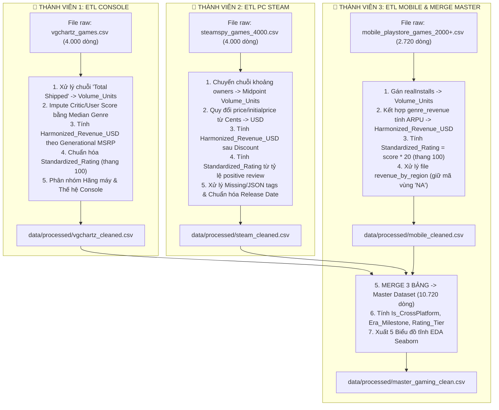

# KẾ HOẠCH PHÂN CÔNG TIỀN XỬ LÝ & ETL DỮ LIỆU (ETL TASK ALLOCATION)

**Đồ án:** Phân Tích Doanh Số & Cạnh Tranh Nền Tảng Ngành Công Nghiệp Game Toàn Cầu  
**Môn học:** Tương tác Dữ liệu Trực quan  
**Trọng số Barem:** **Tiêu chí 1 — Thu thập & Tiền xử lý Dữ liệu (2.5 / 10.0 Điểm)**

---

## 🎯 I. ĐỐI CHIẾU TIÊU CHÍ BAREM TIỀN XỬ LÝ (2.5 ĐIỂM)

| Yêu cầu Barem | Kế hoạch Đáp ứng của Nhóm |
| :--- | :--- |
| **Quy mô $\ge 5.000$ dòng, $\ge 3$ bảng** | • Tổng hợp **3 bảng vi mô:** Console ($4.000$) + PC ($4.000$) + Mobile ($2.720$) = **$10.720$ dòng**. • Bổ trợ **2 bảng vĩ mô:** Benchmark thể loại ($12$) + Thị phần 5 khu vực ($25$). |
| **Data Dictionary rõ ràng** | • Đã hoàn thiện tại file [`docs/data_dictionary.md`](docs/data_dictionary.md) đầy đủ cột, ví dụ, ý nghĩa và link nguồn. |
| **Code Python xử lý Missing, Outlier, Date** | • Phân chia 3 thành viên viết code xử lý triệt để missing, outlier và chuẩn hóa định dạng thời gian. |
| **Calculated Fields có ý nghĩa** | • Tạo **5 trường tính toán chuẩn hóa:** `Volume_Units`, `Harmonized_Revenue_USD`, `Standardized_Rating`, `Rating_Tier`, `Is_CrossPlatform`, `Era_Milestone`. |
| **3–5 Biểu đồ tĩnh EDA (Seaborn/Matplotlib)** | • Xuất 5 biểu đồ tĩnh phân phối, tương quan sau khi merge dữ liệu vào thư mục `visuals/eda_static/`. |

---

## 👥 II. BẢNG PHÂN CÔNG CHI TIẾT TỪNG THÀNH VIÊN

---

## 📋 III. HƯỚNG DẪN KỸ THUẬT CHI TIẾT CHO TỪNG THÀNH VIÊN

---

### 👤 THÀNH VIÊN 1: Tiền xử lý Dataset Console (`vgchartz_games.csv`)
* **Tệp đầu vào:** `data/raw/vgchartz_games.csv` (4.000 dòng, 19 cột)
* **Tệp đầu ra:** `data/processed/vgchartz_cleaned.csv`
* **Các bước lập trình chi tiết:**
  1. **Xử lý `Total Shipped` $\rightarrow$ `Volume_Units`:**
     * Bỏ ký tự `'m'` ở cuối, chuyển sang kiểu số thực và nhân với $1.000.000$ (Ví dụ: `"520.00m"` $\rightarrow 520.000.000$).
  2. **Tính Doanh thu Chuẩn hóa `Harmonized_Revenue_USD`:**
     * Áp dụng giá chuẩn theo thế hệ máy (Generational MSRP):
       $$\text{Harmonized\_Revenue\_USD} = \text{Volume\_Units} \times \text{MSRP}$$
       *(Trong đó: $\text{MSRP} = \$50$ nếu Năm $\le 2005$; $\text{MSRP} = \$60$ nếu $2006 \le \text{Năm} \le 2020$; $\text{MSRP} = \$70$ nếu $\ge 2021$).*
  3. **Xử lý Missing Data & Chuẩn hóa Điểm số `Standardized_Rating`:**
     * Nếu có `Critic Score` (thang 10) $\rightarrow \text{Standardized\_Rating} = \text{Critic Score} \times 10$.
     * Nếu khuyết `Critic Score`, điền (Imputation) bằng giá trị trung vị (`median`) của thể loại (`Genre`) tương ứng.
  4. **Phân nhóm Hãng sản xuất & Thế hệ máy:**
     * Tạo cột `Console_Maker`: Phân loại thành `Sony`, `Microsoft`, `Nintendo`, `Other`.
     * Tạo cột `Console_Gen`: Phân loại thành `Gen 6 (PS2/Xbox/GC)`, `Gen 7 (PS3/X360/Wii)`, `Gen 8 (PS4/XOne/Switch/WiiU)`, `Gen 9 (PS5/XSX)`.
  5. **Chuẩn hóa Ngày phát hành:**
     * Chuyển `Release Date` thành dạng chuẩn `YYYY-MM-DD` và trích xuất `Release_Year` dạng số nguyên.

---

### 👤 THÀNH VIÊN 2: Tiền xử lý Dataset PC Gaming (`steamspy_games_4000.csv`)
* **Tệp đầu vào:** `data/raw/steamspy_games_4000.csv` (4.000 dòng, 23 cột)
* **Tệp đầu ra:** `data/processed/steam_cleaned.csv`
* **Các bước lập trình chi tiết:**
  1. **Xử lý `owners` $\rightarrow$ `Volume_Units`:**
     * Tách chuỗi khoảng (ví dụ: `"100,000,000 .. 200,000,000"`), lấy giá trị trung bình cộng (Midpoint) $\rightarrow 150.000.000$.
  2. **Quy đổi Giá tiền & Tính `Harmonized_Revenue_USD`:**
     * Đổi giá từ Cents sang USD: `price_usd = price / 100.0`.
     * Tính doanh thu thực tế sau chiết khấu:
       $$\text{Harmonized\_Revenue\_USD} = \text{Volume\_Units} \times \left(\text{price\_usd} \times (1 - \frac{\text{discount}}{100})\right)$$
       *(Nếu là game miễn phí `price_usd == 0`, doanh thu tính bằng $0$ USD).*
  3. **Chuẩn hóa Điểm số `Standardized_Rating`:**
     * Tính tỷ lệ phần trăm đánh giá tích cực từ cộng đồng:
       $$\text{Standardized\_Rating} = \frac{\text{positive}}{\text{positive} + \text{negative}} \times 100$$
  4. **Làm sạch Chuỗi & Phân loại:**
     * Trích xuất thể loại chính đầu tiên từ chuỗi `tags` (JSON/Dictionary).
     * Chuẩn hóa `release_date` về định dạng `YYYY-MM-DD` và trích xuất `Release_Year`.
     * Gán cố định: `Platform = 'PC'`, `Platform_Category = 'PC'`, `Publisher_Category = publisher`.

---

### 👤 THÀNH VIÊN 3: Tiền xử lý Dataset Mobile, Merge Master & Xuất 5 Biểu đồ EDA
* **Tệp đầu vào:** 
  * `data/raw/mobile_playstore_games_2000+.csv` (2.720 dòng)
  * `data/external/genre_revenue_2024_2025.csv`
  * `data/external/revenue_by_region(2021 - 2025).csv`
* **Tệp đầu ra:** 
  * `data/processed/mobile_cleaned.csv`
  * `data/processed/master_gaming_clean.csv` ($\ge 10.720$ dòng)
  * 5 ảnh biểu đồ trong `visuals/eda_static/`
* **Các bước lập trình chi tiết:**
  1. **ETL Bảng Mobile:**
     * Gán `Volume_Units = realInstalls`.
     * Tính `Harmonized_Revenue_USD`:
       * Ghép với bảng `genre_revenue_2024_2025.csv` để tính $\text{ARPU}_{\text{Genre}} = \frac{\text{SensorTower\_Revenue}(\text{Genre})}{\sum \text{realInstalls}(\text{Genre})}$.
       * $\text{Harmonized\_Revenue\_USD} = (\text{realInstalls} \times \text{ARPU}_{\text{Genre}}) + (\text{price\_usd} \times \text{realInstalls})$.
     * Chuẩn hóa điểm số: $\text{Standardized\_Rating} = \text{score} \times 20$ (Đưa thang 5 sao về thang 100).
  2. **Tiền xử lý 2 Bảng Vĩ mô (External):**
     * Đọc file `revenue_by_region(2021 - 2025).csv` với tham số `keep_default_na=False` để **giữ nguyên mã vùng `NA` (Bắc Mỹ)**, không bị lỗi thành `NaN`.
  3. **HỢP NHẤT (MERGE) THÀNH MASTER DATASET:**
     * Nối (Concat) 3 bảng `vgchartz_cleaned.csv`, `steam_cleaned.csv`, `mobile_cleaned.csv` theo schema chung 12 cột chuẩn.
     * Tính **3 Calculated Fields toàn cục:**
       * `Rating_Tier`: Phân hạng (`Masterpiece` $\ge 85$, `Great` $75-84$, `Mixed` $50-74$, `Poor` $< 50$).
       * `Is_CrossPlatform`: Đánh dấu `True` nếu tên game xuất hiện trên $\ge 2$ nền tảng khác nhau, ngược lại `False`.
       * `Era_Milestone`: Phân kỳ lịch sử (*Kỷ nguyên Vàng Console*, *Smartphone Boom*, *COVID-19 Peak*, *Hậu suy thoái*).
  4. **Xuất 5 Biểu đồ Tĩnh EDA (Seaborn / Matplotlib):**
     * *Biểu đồ 1:* Histogram & KDE phân phối doanh thu (Log-scale).
     * *Biểu đồ 2:* Correlation Heatmap tương quan giữa các biến định lượng.
     * *Biểu đồ 3:* Boxplot so sánh phân tán doanh số giữa PC vs Console vs Mobile.
     * *Biểu đồ 4:* Countplot phân bổ số lượng game theo thể loại (Genre).
     * *Biểu đồ 5:* Scatter plot tương quan Điểm đánh giá vs Doanh thu.
     * Lưu ảnh vào `visuals/eda_static/eda_1_distribution.png` $\dots$ `eda_5_scatter.png`.

---

## 📐 IV. SCHEMA CHUẨN ĐỒNG BỘ CỦA MASTER DATASET (12 CỘT)

Khi cả 3 thành viên hoàn thành ETL, 3 bảng con sẽ được chuẩn hóa đúng 12 cột sau trước khi ghép lại:

| STT | Tên Cột Chuẩn | Kiểu Dữ Liệu | Mô Tả | Nguồn Dữ Liệu Sau Khi Map |
|:---:|:---|:---|:---|:---|
| 1 | `Game_Title` | String (Text) | Tên chuẩn hóa của tựa game | `Game` / `name` / `title` |
| 2 | `Platform_Category` | String (Categorical) | Nhóm nền tảng chính: `Console`, `PC`, `Mobile` | Phân loại từ 3 bảng |
| 3 | `Specific_Platform` | String (Categorical) | Hệ máy chi tiết: `PS4`, `X360`, `Switch`, `PC`, `Android` | `Platform` / `'PC'` / `'Android'` |
| 4 | `Genre` | String (Categorical) | Thể loại chuẩn hóa (12 thể loại chính) | `Genre` / `genre` / `genre` |
| 5 | `Publisher` | String (Text) | Tên nhà phát hành thương mại | `Publisher` / `publisher` / `developer` |
| 6 | `Developer` | String (Text) | Tên studio phát triển trò chơi | `Developer` / `developer` / `developer` |
| 7 | `Release_Year` | Integer | Năm phát hành chính thức (1980 – 2025) | `Release Year` / `release_year` / `release_year` |
| 8 | `Volume_Units` | Float | Lượng bản bán / Lượng sở hữu / Lượt tải | `Total Shipped` / `owners` / `realInstalls` |
| 9 | `Harmonized_Revenue_USD` | Float | Doanh thu chuẩn hóa (Đơn vị: USD) | Tính toán theo công thức từng bảng |
| 10 | `Standardized_Rating` | Float | Điểm chất lượng chuẩn hóa (Thang 0 – 100) | Chuẩn hóa từ Critic / Positive% / Score |
| 11 | `Rating_Tier` | String (Categorical) | Phân hạng: `Masterpiece`, `Great`, `Mixed`, `Poor` | Calculated Field phân nhóm |
| 12 | `Is_CrossPlatform` | Boolean | Cờ đánh dấu game Đa nền tảng (`True` / `False`) | Calculated Field so khớp tên game |

---

## ⏱️ V. TIẾN ĐỘ & BÀN GIAO (DELIVERABLES CHECKLIST)

* [ ] **Ngày 1–2:** Thành viên 1, 2, 3 hoàn thành code làm sạch riêng lẻ cho 3 dataset.
* [ ] **Ngày 3:** Thành viên 3 nhận file clean từ TV1 và TV2, chạy script ghép `master_gaming_clean.csv`.
* [ ] **Ngày 4:** Kiểm tra tính toàn vẹn (không có null bất thường, quy mô đạt $10.720$ dòng).
* [ ] **Ngày 5:** Xuất 5 ảnh biểu đồ EDA tĩnh và bàn giao Master Data sẵn sàng cho bước dựng Dashboard!
