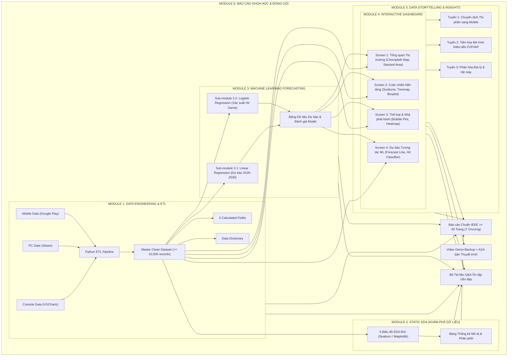
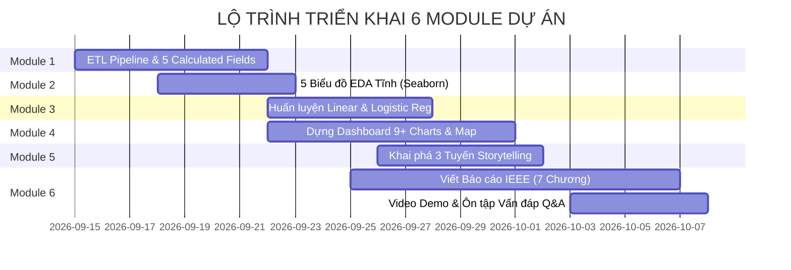

# KẾ HOẠCH TỔNG THỂ THEO MODULE (PROJECT MASTER PLAN BY MODULES)

**Môn học:** Tương tác Dữ liệu Trực quan (Interactive Data Visualization)  
**Đề tài:** Phân Tích Doanh Số & Cạnh Tranh Nền Tảng Ngành Công Nghiệp Game Toàn Cầu (PC vs Console vs Mobile)  
**Mục tiêu kép:** (1) Đạt điểm tối đa **10/10 theo Barem chấm điểm**, (2) Xây dựng Portfolio Project chuyên nghiệp chuẩn Senior Data Analyst.

---

## 🎯 I. TỔNG QUAN & 5 CÂU HỎI NGHIÊN CỨU

1. **Q1 (Dịch chuyển Thị phần):** Thị phần doanh thu giữa 3 nền tảng PC, Console và Mobile đã dịch chuyển như thế nào qua các giai đoạn lịch sử (Bùng nổ Smartphone 2012, Đại dịch COVID-19 2020–2021, và Giai đoạn phục hồi hậu suy thoái 2022–2025)?
2. **Q2 (Cuộc chiến Console Wars):** Trong hệ sinh thái Console, cấu trúc cạnh tranh giữa "Tam mã" Sony (PlayStation), Microsoft (Xbox) và Nintendo thay đổi ra sao qua các thế hệ máy (Gen 6 $\rightarrow$ Gen 9)?
3. **Q3 (Phân rã Địa lý & Thị hiếu):** Thị hiếu về nền tảng và thể loại game giữa các khu vực địa lý lớn (Bắc Mỹ - NA, Châu Âu - EU, Nhật Bản - JP, và Phần còn lại của thế giới - Other) có sự phân hóa như thế nào?
4. **Q4 (Hệ sinh thái Thể loại & Đánh giá):** Mức độ tương quan giữa điểm số đánh giá (Critic Score / User Score) với doanh số thực tế của tựa game trên từng nền tảng? Thể loại và Nhà phát hành nào thống trị thị trường?
5. **Q5 (Mô hình Dự báo Tương lai):** 
   - Xu hướng doanh số ngành game giai đoạn 2026–2030 sẽ ra sao (**Linear Regression**)?
   - Những yếu tố nào (Nền tảng, Thể loại, Điểm đánh giá, Nhà phát hành) quyết định xác suất một tựa game trở thành "Mega-hit" $\ge 1M$ bản (**Logistic Regression**)?

---

## 🏗️ II. SƠ ĐỒ TỔNG THỂ CÁC MODULE HỆ THỐNG

---

## 📦 III. CHI TIẾT TỪNG MODULE CỦA DỰ ÁN

---

### 🔹 MODULE 1: Data Engineering & ETL Pipeline (Thu thập & Tiền xử lý)
*   **Mục tiêu:** Hợp nhất 3 nguồn dữ liệu raw phân mảnh thành 1 Master Clean Dataset đạt chuẩn $\ge 10.000$ dòng.
*   **Đầu vào (Inputs):**
    *   File 1: Console Gaming (`vgchartz.csv`)
    *   File 2: PC Gaming (`steam.csv`)
    *   File 3: Mobile Gaming (`googleplay.csv`)
*   **Quy trình xử lý kỹ thuật:**
    *   Xử lý missing values (Imputation điểm số, điền nhãn cho năm phát hành khuyết).
    *   Lọc bỏ các bản ghi trùng lặp (duplicates) và ngoại lai (outliers) phi lý.
    *   Chuẩn hóa đơn vị tiền tệ (triệu USD) và định dạng ngày tháng.
*   **5 Calculated Fields bắt buộc:**
    1. `Harmonized_Revenue_USD`: Quy đổi chuẩn hóa doanh thu toàn bộ game về cùng đơn vị triệu USD.
    2. `Market_Share_Pct`: Tỷ lệ % đóng góp doanh thu của từng nền tảng/thể loại theo từng năm.
    3. `Era_Milestone`: Nhãn phân kỳ lịch sử (*Gen 6–7*, *Mobile Boom 2012–2019*, *COVID-19 Surge 2020–2021*, *Next-Gen Recovery 2022–2025*).
    4. `Rating_Class`: Phân loại chất lượng tựa game (*Masterpiece $\ge 90$*, *Great $80–89$*, *Good $70–79$*, *Mixed/Low $< 70$*).
    5. `Is_CrossPlatform`: Cờ boolean đánh dấu game phát hành đa nền tảng hay độc quyền (Exclusive).
*   **Đầu ra (Deliverables):**
    *   File dữ liệu sạch `data/processed/master_game_sales.csv` ($\ge 10.000$ dòng).
    *   File từ điển dữ liệu [`docs/data_dictionary.md`](docs/data_dictionary.md).

---

### 🔹 MODULE 2: Exploratory Data Analysis (EDA Tĩnh)
*   **Mục tiêu:** Thám sát phân phối dữ liệu, phát hiện quy luật sơ bộ bằng Python trước khi dựng dashboard.
*   **Nội dung thực hiện (5 Biểu đồ Tĩnh Seaborn / Matplotlib):**
    1. *Biểu đồ 1:* Histogram & KDE log-scale thể hiện phân phối doanh thu toàn cầu (phân phối lệch phải điển hình).
    2. *Biểu đồ 2:* Correlation Heatmap ma trận tương quan giữa các chỉ số định lượng.
    3. *Biểu đồ 3:* Boxplot so sánh phân tán doanh số theo nhóm nền tảng (PC / Console / Mobile).
    4. *Biểu đồ 4:* Countplot phân bổ số lượng tựa game theo thể loại (Genre).
    5. *Biểu đồ 5:* Pairplot đa biến (Sales vs Critic Score vs User Score).
*   **Đầu ra (Deliverables):**
    *   Jupyter Notebook `notebooks/01_data_cleaning_exploration.ipynb`.
    *   5 file ảnh chất lượng cao lưu trong thư mục `visuals/`.

---

### 🔹 MODULE 3: Machine Learning & Predictive Modeling (Mô hình Dự báo)
*   **Mục tiêu:** Áp dụng phương pháp toán học và thống kê học để dự báo xu hướng và phân loại thành công của game.
*   **Sub-module 3.1: Hồi quy Tuyến tính (Linear Regression - Time Series Trend):**
    *   *Nhiệm vụ:* Dự báo quy mô doanh thu và thị phần của từng nền tảng giai đoạn 2026–2030.
    *   *Đánh giá mô hình:* Chỉ số $R^2$, RMSE, MAE và dải tin cậy 95% (Confidence Interval).
*   **Sub-module 3.2: Hồi quy Logistic (Logistic Regression - Hit Game Classifier):**
    *   *Nhiệm vụ:* Dự đoán xác suất một tựa game đạt mức doanh số "Mega-hit" ($\ge 1.0$ triệu bản).
    *   *Đặc trưng đầu vào:* Thể loại (Genre), Nền tảng (Platform), Nhà phát hành lớn (Is_Major_Publisher), Điểm đánh giá (Critic/User Score).
    *   *Đánh giá mô hình:* Accuracy, Precision, Recall, F1-Score, Confusion Matrix và ROC-AUC Curve.
*   **Đầu ra (Deliverables):**
    *   File dữ liệu dự báo `data/processed/forecast_results.csv` sẵn sàng nạp vào Dashboard.
    *   Notebook huấn luyện `notebooks/02_advanced_analytics_insights.ipynb`.

---

### 🔹 MODULE 4: Interactive Dashboard & Visual Analytics (Trực quan hóa Tương tác)
*   **Mục tiêu:** Xây dựng hệ thống Dashboard tương tác đa chiều trên Tableau / Power BI (hoặc Streamlit) đáp ứng đủ **$\ge 8$ loại biểu đồ** và **bắt buộc có bản đồ không gian**.
*   **Kiến trúc 4 Màn hình / Story Points:**
    *   *Màn hình 1 (Tổng quan Thị trường Toàn cầu):*
        *   **Biểu đồ 1 (Bắt buộc):** **Choropleth Map** (Bản đồ thế giới thể hiện doanh số theo vùng NA, EU, JP, Other).
        *   **Biểu đồ 2:** **100% Stacked Area Chart** (Dịch chuyển thị phần qua các năm kèm mốc sự kiện).
        *   **Biểu đồ 3:** **Multi-line Chart with Trendlines** (Doanh thu & Số lượng game theo chu kỳ).
        *   *Thẻ KPI:* Tổng doanh thu, Số lượng tựa game, Nền tảng dẫn đầu, Tăng trưởng YoY.
    *   *Màn hình 2 (Cuộc chiến Nền tảng & Console Wars):*
        *   **Biểu đồ 4:** **Donut / Sunburst Chart** (Thị phần nội bộ Console: Sony vs Microsoft vs Nintendo).
        *   **Biểu đồ 5:** **Treemap Phân cấp** (Nền tảng $\rightarrow$ Nhà phát hành $\rightarrow$ Thể loại).
        *   **Biểu đồ 6:** **Box Plot / Violin Plot** (Phân phối doanh thu và mức độ rủi ro giữa các hệ máy).
    *   *Màn hình 3 (Hệ sinh thái Thể loại & Nhà phát hành):*
        *   **Biểu đồ 7:** **Grouped / Stacked Bar Chart** (Top 10 Publishers thống trị từng nền tảng).
        *   **Biểu đồ 8:** **Interactive Bubble / Scatter Plot** (Doanh thu vs Critic Score vs User Score).
        *   **Biểu đồ 9:** **Correlation Heatmap** (Mức độ ưa chuộng thể loại trên từng nền tảng).
    *   *Màn hình 4 (Dự báo Tương tác & Khám phá Kịch bản):*
        *   **Biểu đồ 10:** **Forecast Chart** (Đường dự báo Linear Regression 2026–2030 kèm dải tin cậy).
        *   **Giao diện mô phỏng:** Khám phá xác suất thành công của tựa game dựa trên mô hình Logistic Regression.
*   **Tính năng tương tác:** Multi-filters (Năm, Nền tảng, Thể loại, Vùng), Drill-down Console $\rightarrow$ Hãng máy, Cross-filtering, Custom Tooltip.
*   **Đầu ra (Deliverables):**
    *   File Dashboard `.pbix` / `.twbx` hoặc link tương tác trực tiếp trên Tableau Public / Web.

---

### 🔹 MODULE 5: Data Storytelling & Business Insights (Khai phá Insight Chuyên sâu)
*   **Mục tiêu:** Rút ra các insight kinh doanh và câu chuyện dữ liệu có chiều sâu thực tiễn.
*   **3 Tuyến câu chuyện cốt lõi:**
    *   *Tuyến 1 (Sự soán ngôi của Mobile):* Phân tích quá trình Mobile vươn lên chiếm >50% thị phần toàn cầu nhờ rào cản tiếp cận thấp và sự phổ cập của smartphone.
    *   *Tuyến 2 (Tiến hóa Mô hình Kiếm tiền):* Phân tích bước chuyển dịch từ mô hình trả phí một lần (Buy-to-Play) sang Game-as-a-Service (F2P, In-App Purchases, Battle Pass và Subscription).
    *   *Tuyến 3 (Phân rã Địa lý & Cuộc chiến Console):* Lý giải tại sao Bắc Mỹ chuộng Shooter/Action, Nhật Bản trung thành với JRPG/Handheld, và so sánh vòng đời thành bại giữa PS4/Xbox One và PS5/Xbox Series.
*   **Đầu ra (Deliverables):**
    *   Nội dung chuyên sâu tích hợp vào Chương 4 Báo cáo IEEE và Slide thuyết trình.

---

### 🔹 MODULE 6: Academic Reporting & Deliverables (Báo cáo Khoa học & Bàn giao)
*   **Mục tiêu:** Đóng gói trọn bộ sản phẩm theo chuẩn học thuật IEEE $\ge 40$ trang, kịch bản demo và tài liệu ôn tập vấn đáp.
*   **Sub-module 6.1: Báo cáo Khoa học Chuẩn IEEE ($\ge 40$ Trang - 7 Chương Bắt Buộc):**
    *   *Chương 1:* Giới thiệu đề tài & Mô tả tập dữ liệu (5 câu hỏi nghiên cứu, Data Dictionary).
    *   *Chương 2:* Quy trình Tiền xử lý & Khám phá dữ liệu EDA (5 Calculated Fields, 5 biểu đồ tĩnh).
    *   *Chương 3:* Thiết kế Kiến trúc Dashboard & Trực quan hóa (Lý thuyết chọn 9+ biểu đồ, UX/UI).
    *   *Chương 4:* Khai phá Insight Chuyên sâu (3 Tuyến Storytelling kèm dẫn chứng số liệu).
    *   *Chương 5:* Mô hình Dự báo Machine Learning (Cơ sở toán học, đánh giá chỉ số $R^2$, RMSE, ROC-AUC).
    *   *Chương 6:* Hướng dẫn Cài đặt, Sử dụng & Video Demo.
    *   *Chương 7:* Kết luận, Hạn chế của dữ liệu, Hướng phát triển & Danh mục tài liệu tham khảo IEEE.
*   **Sub-module 6.2: Video Demo Backup & Kịch bản Thuyết trình:**
    *   Kịch bản trình bày phân tích dữ liệu chuyên nghiệp (Script 7–10 phút).
    *   Video quay lại thao tác tương tác trên dashboard.
*   **Sub-module 6.3: Bộ Tài liệu Q&A Ôn tập Vấn đáp:**
    *   Tổng hợp toàn bộ các câu hỏi phản biện kỹ thuật, công thức toán và phân tích nghiệp vụ để bảo vệ điểm số tối đa.
*   **Đầu ra (Deliverables):**
    *   File Báo cáo hoàn chỉnh (`.pdf`, `.docx` $\ge 40$ trang).
    *   Video Demo, Slide thuyết trình và File tài liệu Q&A.

---

## 📅 IV. MA TRẬN PHỤ THUỘC & LỘ TRÌNH THEO MODULE (MODULE DEPENDENCY ROADMAP)

