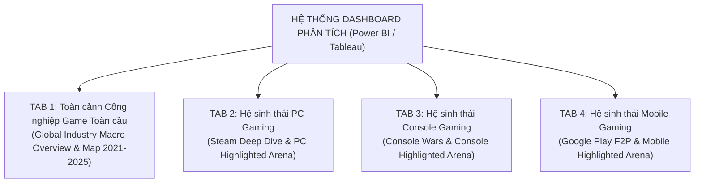
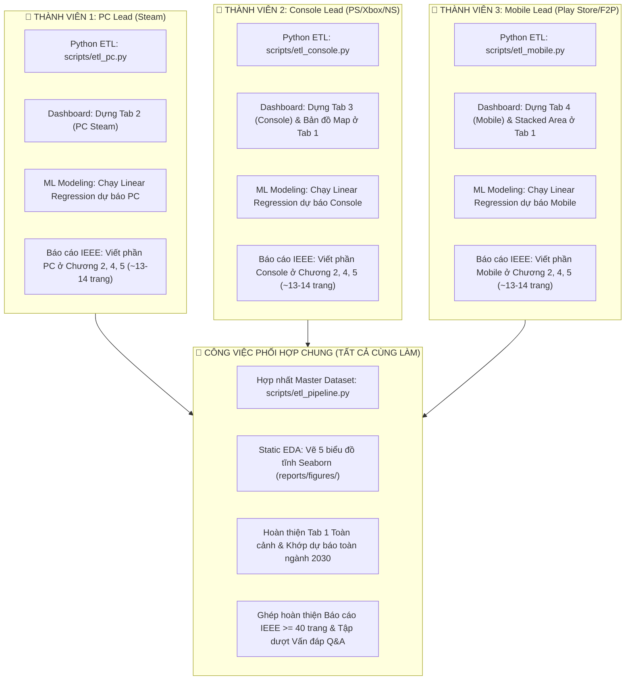

# Project Overview: Phân Tích Doanh Số & Cạnh Tranh Nền Tảng Ngành Công Nghiệp Game Toàn Cầu
**(Global Gaming Market Revenue & Platform Battle: PC vs Console vs Mobile)**

* **Môn học:** Tương tác Dữ liệu Trực quan (Interactive Data Visualization)
* **Loại đề tài:** Đồ án Cuối kỳ
* **Định vị sản phẩm:** Chuẩn Portfolio Business Intelligence / Visual Analytics (10/10 Barem học thuật & Sẵn sàng đưa vào CV ứng tuyển Data Analyst)
* **Nền tảng triển khai Dashboard:** **Power BI / Tableau** (kết hợp Pipeline Tiền xử lý ETL & EDA bằng Python)
* **Quy mô nhóm:** **3 thành viên** (Phân chia công việc theo mô hình Trục Dọc - Ai cũng làm đủ 4 khâu: Python ETL $\rightarrow$ Dashboard $\rightarrow$ ML Dự báo $\rightarrow$ Báo cáo IEEE)

---

## 1. Bối cảnh & Mục tiêu Đồ án

### 1.1. Bối cảnh ngành
Ngành công nghiệp game toàn cầu là lĩnh vực giải trí có tốc độ tăng trưởng nhanh nhất và sở hữu cấu trúc thị trường biến chuyển liên tục. Trong suốt hơn 4 thập kỷ (1980 – 2025), sự tương quan quyền lực giữa 3 nền tảng trụ cột — **PC, Console, Mobile** — đã trải qua những cuộc cách mạng sâu sắc:
- **Thời kỳ Console Thống trị (1980 – 2005):** Kỷ nguyên bán đĩa vật lý (Boxed/Premium), sự cạnh tranh khốc liệt giữa Nintendo, Sony (PlayStation) và Microsoft (Xbox). Mức giá bán lẻ được neo chuẩn theo thế hệ máy (\$49.99 $\rightarrow$ \$59.99).
- **Kỷ nguyên PC Bền bỉ & Số hóa (2003 – nay):** Sự ra đời của nền tảng Steam, văn hóa eSports, game chiến thuật và cộng đồng modding vững chắc, thúc đẩy mạnh mẽ phân khúc game độc lập (Indie).
- **Cơn địa chấn Mobile & Live-Service (2010 – nay):** Smartphone bùng nổ kéo theo mô hình Free-to-Play (F2P) và Mua hàng trong ứng dụng (In-App Purchases - IAP), định hình lại hoàn toàn khái niệm "người chơi game" và chiếm hơn 50% doanh thu toàn ngành.
- **Xu hướng Xóa nhòa ranh giới (Cross-Platform):** Sự trỗi dậy của các tựa game đa nền tảng (Minecraft, Genshin Impact, Fortnite, GTA V) buộc các ông lớn phải từ bỏ chiến lược độc quyền đóng kín.

### 1.2. Mục tiêu dự án
1. **Tiền xử lý & Hợp nhất Dữ liệu Đa nguồn (ETL Pipeline):** Làm sạch, chuẩn hóa và kết nối 5 bộ dữ liệu trong thư mục `dataset/` với tổng quy mô **10.757 bản ghi** (vượt xa chuẩn barem $\ge 5.000$ dòng).
2. **Chuẩn hóa Chỉ số Đa chiều (Dual-Metric Harmonization):** Giải quyết bài toán không đồng nhất dữ liệu bằng cách theo dõi song song: **Doanh số về Lượng** (Bản bán/Người sở hữu/Lượt tải), **Doanh số về Giá trị Tiền tệ** (USD Revenue), và **Điểm Đánh giá Chuẩn hóa** (`Standardized_Rating` 0–100).
3. **Phân tích Cạnh tranh Đột phá với Hiệu ứng Visual Highlighting:** Xây dựng Dashboard tương tác 4 Tab trên **Power BI / Tableau**. Tại 3 Tab nền tảng, tích hợp biểu đồ đối đầu ma trận **Chất lượng (Rating) vs Quy mô (Revenue & Reach)** với hiệu ứng làm nổi bật nền tảng chủ đạo và làm mờ đối thủ.
4. **Bản đồ Không gian Địa lý (Geographic Choropleth Map):** Trực quan hóa phân bổ thị trường 5 khu vực địa lý toàn cầu (APAC, NA, EU, LATAM, MENA) trong chuỗi 5 năm liên tiếp (2021 – 2025) đáp ứng tiêu chí bắt buộc của barem.
5. **Dự báo Xu hướng Thị trường đến năm 2030:** Sử dụng mô hình **Hồi quy Tuyến tính (Linear Regression)** để dự phóng doanh thu và thị phần chuyển dịch của PC, Console và Mobile đến năm 2030 kèm dải tin cậy (Confidence Interval 95%).

---

## 2. Câu Hỏi Nghiên Cứu Cốt Lõi (5 Research Questions)

1. **RQ1 (Sự Dịch chuyển Thị phần - Macro Market Shift):** Cơ cấu thị phần doanh số và miếng bánh doanh thu toàn cầu giữa PC, Console và Mobile đã biến đổi như thế nào từ năm 1980 đến năm 2025 dưới tác động của các cột mốc công nghệ (Console Next-Gen, Smartphone Boom, Đại dịch COVID-19)?
2. **RQ2 (Chiến địa Thể loại - Genre Battlefield):** Nền tảng nào nắm giữ vị thế "thống trị độc tôn" ở từng thể loại game cụ thể (Strategy/Shooter trên PC, Casual/Puzzle trên Mobile, Sports/Action trên Console)? Liệu RPG có phải là đấu trường cạnh tranh khốc liệt nhất giữa cả 3 bên?
3. **RQ3 (Nghịch lý Chất lượng, Quy mô & Doanh thu - The Quality-Reach-Monetization Paradox):** Mối quan hệ giữa Chất lượng sản phẩm (`Standardized_Rating`) và Thành công thương mại (Sales/Revenue) diễn biến ra sao? Mức độ nhạy cảm của doanh số theo điểm đánh giá khác nhau thế nào giữa Console (\$70/đĩa, Critic-driven), PC (Steam Community-driven) và Mobile (F2P/Volume-driven)?
4. **RQ4 (Sức mạnh của Game Đa Nền tảng - Cross-Platform Power):** Các tựa game phát hành đa nền tảng (`Is_CrossPlatform = True`) có mang lại doanh số, lượt tiếp cận và vòng đời thương mại vượt trội hơn so với các tựa game phát hành độc quyền (Platform-Exclusive) hay không?
5. **RQ5 (Dự phóng Thị phần đến 2030 - Market Projection):** Dựa trên dữ liệu chuỗi thời gian lịch sử, mô hình Linear Regression dự báo xu hướng doanh thu và thị phần của 3 nền tảng sẽ diễn tiến ra sao trong giai đoạn 2026 – 2030?

---

## 3. Kiến Trúc & Thiết Kế Dashboard 4 Tab (Power BI / Tableau)

Dashboard được thiết kế theo tư duy kể chuyện dữ liệu (Data Storytelling) chuyên nghiệp với cấu trúc 4 Tab riêng biệt. 

Tại cả 3 Tab nền tảng (Tab 2, 3, 4), dự án áp dụng nguyên lý **Consistent Benchmark Framing (Khung so sánh nhất quán)** kết hợp **Visual Highlighting & Contextual Dimming (Làm nổi bật theo ngữ cảnh)**: Sử dụng cùng một loại biểu đồ so sánh đối đầu **Chất lượng (Rating) vs Doanh thu (USD)**, trong đó nền tảng của Tab đó sẽ được tô màu thương hiệu đậm và sắc nét, còn 2 đối thủ còn lại được làm mờ (màu xám nhạt với độ mờ 25%) để làm nền đối chứng.

### Tab 1: Toàn Cảnh Công Nghiệp Game Toàn Cầu (Macro Overview)
*Mục tiêu: Đem lại cái nhìn vĩ mô toàn diện về quy mô ngành, lịch sử chuyển dịch và phân bổ địa lý.*
1. **KPI Cards:** Tổng quy mô doanh thu ngành ước tính (USD), Tổng tựa game theo dõi, Tỷ trọng thị phần hiện tại (% PC, % Console, % Mobile), Điểm đánh giá trung bình toàn ngành.
2. **100% Stacked Area Chart (Timeline 1980 – 2025):** Sự dịch chuyển miếng bánh thị phần doanh số giữa PC, Console và Mobile qua 4 thập kỷ, gắn nhãn sự kiện (Ra mắt PS2, iPhone ra đời, COVID-19).
3. **Choropleth Map (Bản đồ Địa lý 2021–2025 - Bắt buộc theo Barem):** Bản đồ nhiệt không gian thể hiện thị phần (%) và tốc độ tăng trưởng (% YoY) của 5 khu vực địa lý toàn cầu (APAC, NA, EU, LATAM, MENA) có thanh trượt `Year Slider (2021-2025)`.
4. **Grouped Bar Chart (Chiến địa Thể loại):** So sánh doanh số 3 nền tảng trên từng thể loại game (Genre Battlefield) để định danh "vua thể loại".
5. **Interactive Forecasting Chart (Linear Regression 2026–2030):** Đường xu hướng dự báo doanh thu và thị phần 3 nền tảng đến năm 2030 kèm dải tin cậy 95%.

### Tab 2: Hệ Sinh Thái PC Gaming (Steam Deep Dive)
*Mục tiêu: Đào sâu vào nền tảng Steam, văn hóa game Indie điểm cao, và so sánh đối đầu nổi bật PC.*
1. **Biểu đồ Đối đầu Nổi bật (PC Highlighted Arena):**
   * *Dạng biểu đồ:* Bubble Plot — **Trục X = Rating (0-100), Trục Y = Doanh thu ước tính (USD), Kích thước bóng = Quy mô người chơi**.
   * *Hiệu ứng thị giác:* **PC sáng rực màu Xanh Steam (Steam Blue)**, trong khi Console và Mobile chuyển màu xám mờ (25% opacity).
   * *Insight trọng tâm:* Thể hiện rõ nét dải game **Hidden Gems / Indie** với điểm số đánh giá cực cao ($\ge 85$) dù giá bán thấp và doanh thu bền bỉ.
2. **Bubble / Scatter Plot nội bộ PC:** Trục X = Giá game (`price`), Trục Y = Lượng người sở hữu (`owners`), Màu sắc = Tỷ lệ đánh giá tích cực (`positive_ratio`).
3. **Heatmap Ma trận Tags & Genres:** Mức độ phổ biến và thời gian chơi trung bình (`median_forever`) theo từng thể loại PC.
4. **Donut Chart (Mô hình Kinh doanh PC):** Tỷ trọng Game Free-to-Play vs Buy-to-Play trên Steam.
5. **Top Publishers / Developers Bar Chart:** Xếp hạng các studio thống trị nền tảng PC (Valve, Bethesda, Ubisoft, Indie studios).

### Tab 3: Hệ Sinh Thái Console Gaming (Console & Tam Mã Chiến)
*Mục tiêu: Phân tích cuộc chiến máy chơi game gia đình và rào cản chất lượng khắt khe của game AAA.*
1. **Biểu đồ Đối đầu Nổi bật (Console Highlighted Arena):**
   * *Dạng biểu đồ:* Bubble Plot — **Trục X = Rating (0-100), Trục Y = Doanh thu ước tính (USD), Kích thước bóng = Quy mô người chơi**.
   * *Hiệu ứng thị giác:* **Console sáng bừng màu Đỏ/Tím thương hiệu**, PC và Mobile lùi về làm nền màu xám mờ.
   * *Insight trọng tâm:* Thể hiện rõ Console là "ông vua" của phân khúc **Mega-Hits** (Góc phần tư trên cùng bên phải: Điểm $\ge 85$ đi kèm doanh số bán đĩa bùng nổ \$60–\$70/bản).
2. **Tam Mã Chiến - Console Wars (PlayStation vs Xbox vs Nintendo):** 
   - Biểu đồ Area/Line so sánh doanh số bán máy và phần mềm qua từng thế hệ (PS2 vs Xbox vs GameCube $\rightarrow$ PS3 vs X360 vs Wii $\rightarrow$ PS4 vs XOne vs Switch $\rightarrow$ PS5 vs Series X).
3. **Treemap Cấu trúc Thị phần Console:** Phân cấp Hệ máy $\rightarrow$ Nhà phát hành $\rightarrow$ Thể loại game.
4. **Boxplot Phân phối Điểm Đánh giá (Critic vs User Score):** Đo lường sự đồng thuận hoặc phân hóa giữa giới phê bình báo chí và cộng đồng người chơi console.
5. **Cross-Platform vs Exclusive Analysis:** So sánh doanh số game độc quyền của hãng (Sony Exclusive, Nintendo First-party) so với game phát hành đa hệ máy.

### Tab 4: Hệ Sinh Thái Mobile Gaming (Google Play & F2P Era)
*Mục tiêu: Thể hiện nghịch lý người dùng khổng lồ, chiến lược kiếm tiền IAP và sự thống trị thể loại Casual.*
1. **Biểu đồ Đối đầu Nổi bật (Mobile Highlighted Arena):**
   * *Dạng biểu đồ:* Bubble Plot — **Trục X = Rating (0-100), Trục Y = Doanh thu ước tính (USD), Kích thước bóng = Quy mô người chơi**.
   * *Hiệu ứng thị giác:* **Mobile sáng bừng màu Xanh Lá Cây Android**, PC và Console lùi về làm nền màu xám mờ.
   * *Insight trọng tâm:* Chỉ ra "Nghịch lý Mobile": Điểm số dồn cục ở mức 70–85 điểm, nhưng bóng lượt tải (`realInstalls`) to áp đảo toàn thị trường. Mobile kiếm tiền dựa trên độ phủ người dùng và IAP chứ không phụ thuộc vào điểm số nhà phê bình.
2. **Nghịch lý Quy mô (Reach vs Value Bar Chart):** So sánh thị phần lượt cài đặt (`realInstalls` chiếm áp đảo >80%) với thị phần doanh thu thực tế.
3. **Cơ cấu Kiếm tiền Mobile (Donut / Sunburst):** Tỷ lệ game Free vs Paid và tỷ lệ tích hợp In-App Purchases (IAP).
4. **Radar Chart (Sự thống trị Thể loại Casual/Puzzle/Gacha):** So sánh lượng cài đặt và điểm đánh giá của các thể loại trên kho ứng dụng.
5. **Content Rating & Review Volume Correlation:** Tương quan giữa độ tuổi người chơi (Everyone, Teen, Mature), số lượng đánh giá và lượt cài đặt thành công.

---

## 4. Danh Mục Dữ Liệu & Quy Trình Chuẩn Hóa Chỉ Số

### 4.1. Danh mục 5 Tập Dữ liệu Đầu vào Thực tế

| Tên Dataset | Nền tảng đại diện | Số dòng thực tế | Số cột | Đơn vị đo lường gốc | Vai trò trong hệ thống |
|---|---|:---:|:---:|---|---|
| `vgchartz_games.csv` | **Console & History** | **4.000** | 19 | `Total Shipped` (Triệu bản bán), Điểm số | Micro Console dataset (1971–2025) |
| `steamspy_games_4000.csv` | **PC (Steam)** | **4.000** | 23 | `owners` (Khoảng), `price` (cents), Reviews | Micro PC dataset (1997–2025) |
| `mobile_playstore_games_2000+.csv` | **Mobile (Google Play)** | **2.720** | 23 | `realInstalls` (Lượt tải), `score` (Sao), IAP | Micro Mobile dataset (2010–2025) |
| `genre_revenue_2024_2025.csv` | **Macro Genre Benchmark** | **12** | 5 | Doanh thu thực tế theo 12 thể loại (Tỷ USD) | Benchmark chuẩn hóa ARPU Mobile |
| `revenue_by_region(2021 - 2025).csv` | **Geographic Market Share** | **25** | 5 | Thị phần (%) & YoY Growth (%) theo 5 vùng | Phục vụ Choropleth Map 2021–2025 |

### 4.2. Phương Pháp Chuẩn Hóa Chỉ Số Đa Chiều (5 Calculated Fields)

1. **Doanh số về LƯỢNG (Volume / Audience Reach):**
   * *Console:* `Volume_Units` = `Total_Shipped` quy đổi sang số nguyên (Triệu bản đĩa $\times 1.000.000$).
   * *PC (Steam):* `Volume_Units` = `Midpoint(owners)` (Quy đổi khoảng `'10M .. 20M'` thành số trung vị $15.000.000$).
   * *Mobile:* `Volume_Units` = `realInstalls` (Số lượt tải thực tế).

2. **Doanh số về GIÁ TRỊ THU LẠI (Estimated Value / Revenue USD):**
   * *Console:* $\text{Estimated\_Revenue}_{\text{Console}} = \text{Volume\_Units} \times \text{MSRP}_{\text{Era}}$  
     *(MSRP chuẩn theo thời kỳ: \$50 trước năm 2005, \$60 giai đoạn 2006–2020, \$70 từ 2021 đến nay theo Circana/NPD standard).*
   * *PC:* $\text{Estimated\_Revenue}_{\text{PC}} = \text{Volume\_Units} \times \left(\frac{\text{price}}{100} \times (1 - \frac{\text{discount}}{100})\right)$
   * *Mobile:* $\text{Estimated\_Revenue}_{\text{Mobile}} = \text{realInstalls} \times \text{ARPU}_{\text{Genre}} + (\text{price\_usd} \times \text{realInstalls})$  
     *(Trong đó $\text{ARPU}_{\text{Genre}}$ được tính toán hiệu chỉnh từ tổng doanh thu thể loại của file `genre_revenue_2024_2025.csv` chia cho tổng lượng cài đặt của thể loại tương ứng).*

3. **Chỉ số Chất lượng Chuẩn hóa (`Standardized_Rating` thang 0 – 100):**
   $$\text{Standardized\_Rating} = 
   \begin{cases} 
   \text{Critic Score} \times 10 & \text{(Console: thang 0--10)} \\
   \text{Metacritic Score} & \text{(Console/PC: thang 0--100)} \\
   \dfrac{\text{positive}}{\text{positive} + \text{negative}} \times 100 & \text{(PC Steam: Tỷ lệ \% đánh giá tích cực)} \\
   \text{score} \times 20 & \text{(Mobile: thang 0--5 sao)}
   \end{cases}$$

4. **Phân cấp Chất lượng (`Rating_Tier` dùng làm Slicer Dashboard):**
   * `Masterpiece`: Điểm $\ge 85$ | `Great`: Điểm $75 - 84$ | `Mixed`: Điểm $50 - 74$ | `Poor`: Điểm $< 50$.

5. **Trường phân loại Cross-Platform (`Is_CrossPlatform`):**
   * Thuật toán Fuzzy Matching so khớp chuỗi tiêu đề (`Game_Title`) giữa 3 bảng $\longrightarrow \text{True}$ (nếu phát hành đa nền tảng) hoặc $\text{False}$ (độc quyền).

---

## 5. Phương Pháp Dự Báo (Linear Regression Modeling)

- **Thuật toán:** Hồi quy Tuyến tính Đa biến / Chuỗi thời gian (Multivariate / Time-Series Linear Regression).
- **Mục tiêu dự báo:** 
  1. Tổng doanh thu ngành game toàn cầu giai đoạn **2026 – 2030**.
  2. Tỷ trọng thị phần (% Market Share) của 3 nền tảng PC, Console và Mobile giai đoạn **2026 – 2030**.
- **Chỉ số đánh giá độ tin cậy:** Hệ số xác định $R^2$, Sai số toàn phương trung bình (RMSE), và Sai số phần trăm tuyệt đối trung bình (MAPE).
- **Trực quan hóa trên Dashboard:** Biểu đồ đường (Line Chart) kết hợp vùng bóng thể hiện khoảng tin cậy 95% (95% Confidence Intervals) tích hợp tại Tab 1.

---

## 6. Kế Hoạch Phân Chia Công Việc 3 Thành Viên (Vertical Domain Ownership)

Nhằm đảm bảo **cả 3 thành viên đều có đóng góp thực tế vào 100% các khâu** (Python ETL, Thiết kế Dashboard, Mô hình ML, Viết Báo cáo) để khi giảng viên vấn đáp chéo bất kỳ ai cũng trả lời tự tin, dự án áp dụng mô hình phân chia theo **Trục Dọc Nền Tảng (Vertical Domain Slicing)**:

### Chi tiết phân công nhiệm vụ cụ thể:

| Khâu công việc | 👤 Thành viên 1 (PC Lead) | 👤 Thành viên 2 (Console Lead) | 👤 Thành viên 3 (Mobile Lead) |
|---|---|---|---|
| **1. Python ETL Pipeline** | • Viết `scripts/etl_pc.py` • Xử lý Steam price cents, owners midpoint, reviews % | • Viết `scripts/etl_console.py` • Xử lý Shipped, MSRP Era, nạp file địa lý 2021–2025 | • Viết `scripts/etl_mobile.py` • Xử lý realInstalls, tính ARPU từ file Genre |
| *(Phối hợp ETL)* | *(Cả 3 cùng ghép code vào `scripts/etl_pipeline.py` để xuất Master Dataset và chạy `validate_data.py`)* | | |
| **2. Thiết kế Dashboard** | • **Dựng TAB 2: Nền tảng PC** (biểu đồ Indie, giá bán, reviews, highlight PC) | • **Dựng TAB 3: Nền tảng Console** (Console wars Tam Mã, highlight Console) • **Dựng Bản đồ Map 2021–2025 ở Tab 1** | • **Dựng TAB 4: Nền tảng Mobile** (Nghịch lý lượt tải vs IAP, highlight Mobile) • **Dựng Stacked Area 100% ở Tab 1** |
| **3. Mô hình Dự báo ML** | • Chạy mô hình hồi quy dự báo **Doanh thu PC** đến 2030 | • Chạy mô hình hồi quy dự báo **Doanh thu Console** đến 2030 | • Chạy mô hình hồi quy dự báo **Doanh thu Mobile** đến 2030 |
| *(Phối hợp ML)* | *(Cả 3 cùng tích hợp 3 đường hồi quy thành Biểu đồ Dự báo Toàn ngành 2026–2030 trên Tab 1)* | | |
| **4. Báo cáo IEEE ($\ge 40$ trang)** | • Viết phần nội dung PC ở Chương 2, 4, 5 (~13 trang) • Viết Mở đầu Chương 1 | • Viết phần nội dung Console ở Chương 2, 4, 5 (~13 trang) • Viết Thiết kế chung Chương 3 | • Viết phần nội dung Mobile ở Chương 2, 4, 5 (~13 trang) • Viết Chương 6 (Hướng dẫn) & Chương 7 (Kết luận) |
| *(Phối hợp Báo cáo & QA)* | *(Cả 3 cùng rà soát chéo, quay Video Demo sản phẩm, và ôn tập bộ tài liệu phản biện `docs/qa_defense_prep.md`)* | | |

---

## 7. Kế Hoạch Đáp Ứng Barem Điểm (10/10)

| Hạng mục Barem | Trọng số | Yêu cầu chuẩn | Giải pháp thực hiện của Đồ án |
|---|---|---|---|
| **1. Thu thập & Tiền xử lý** | **2.5 điểm** | $\ge 5.000$ dòng, $\ge 3$ bảng merge, Data Dictionary chi tiết, code Python xử lý missing/outlier, Calculated Fields, 3-5 biểu đồ EDA tĩnh. | • 5 Dataset gốc (**10.757 dòng**). • Pipeline Python tự động làm sạch, xử lý missing/outlier. • Tạo 5 calculated fields: `Volume_Units`, `Estimated_Revenue_USD`, `Standardized_Rating`, `Rating_Tier`, `Is_CrossPlatform`. • Bộ 5 biểu đồ EDA tĩnh (Seaborn/Matplotlib) lưu vào `reports/figures/`. |
| **2. Thiết kế Dashboard** | **3.5 điểm** | Power BI / Tableau mượt mà, $\ge 8$ loại biểu đồ khác nhau, **bắt buộc có $\ge 1$ Geographic Map**, tương tác bộ lọc đa tầng, drill-down, tooltip. | • Dashboard **4 Tab chuyên nghiệp** trên Power BI / Tableau. • **9+ loại biểu đồ:** 100% Stacked Area, Grouped Bar, Choropleth Map (2021–2025), Quadrant Bubble Plot (Rating vs Revenue), Donut, Heatmap, Boxplot, Treemap, Radar Chart. • **Choropleth Map** chuỗi 5 năm liên tiếp 2021–2025 theo 5 khu vực APAC, NA, EU, LATAM, MENA. • Bộ lọc Slicers, Drill-down Console -> Hãng, Kỹ thuật Visual Highlighting ở cả 3 Tab đối đầu. |
| **3. Insight & Dự báo** | **2.0 điểm** | Storytelling sắc sảo, chỉ rõ nguyên nhân biến động, áp dụng Linear Regression, trực quan hóa kết quả lên Dashboard. | • Trả lời trọn vẹn 5 câu hỏi nghiên cứu (RQ1 - RQ5). • Phân tích sâu 4 góc phần tư: Mega-Hits, Cash Cows, Hidden Gems, Flops. • Mô hình Linear Regression dự phóng 2026–2030 tích hợp trực tiếp lên Tab 1 Dashboard. |
| **4. Báo cáo & Video Demo** | **2.0 điểm** | Báo cáo chuẩn IEEE $\ge 40$ trang (7 chương bắt buộc), video demo kịch bản lôi cuốn. | • Báo cáo khoa học IEEE hoàn chỉnh $\ge 40$ trang với hình ảnh, bảng biểu, công thức toán. • Video demo backup chất lượng cao + Kịch bản thuyết trình phong thái Data Analyst. |
| **Vấn đáp tại lớp** | **Chống trừ điểm** | Nắm chắc 100% logic code, công thức quy đổi và thao tác dashboard. | • Cả 3 thành viên đều làm đủ 4 khâu, ôn tập kỹ bộ câu hỏi phản biện `docs/qa_defense_prep.md`. |
