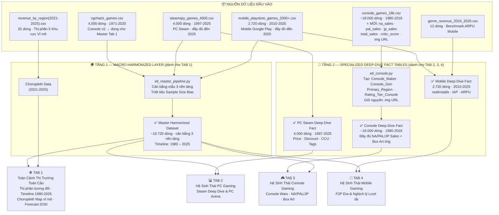

# Project Overview V2: Kiến Trúc Hai Tầng — Tích Hợp Dataset Console 18k Mới
**(Revised Project Plan — Two-Tier Multi-Fact BI Architecture)**

> **Đây là bản kế hoạch nâng cấp** bổ sung cho [`project_overview.md`](project_overview.md) gốc.  
> Áp dụng khi nhóm tích hợp thêm bộ dữ liệu Console mới (~18.000 dòng, có `na_sales`, `pal_sales`, `jp_sales`, `total_sales`, `critic_score`, `img`).

---

## 1. Lý Do Nâng Cấp Kiến Trúc

Bộ `vgchartz_games.csv` gốc (4.000 dòng) có **3 vấn đề nghiêm trọng**:
- `Total Sales`, `NA Sales`, `PAL Sales`, `Japan Sales`, `Other Sales` → **rỗng 100%** (4.000/4.000 dòng).
- Không thể vẽ Bản đồ phân rã địa lý NA vs EU vs JP ở Tab 3.
- Thiếu ảnh bìa để làm tooltip trực quan sinh động.

Bộ Console mới 18k giải quyết tất cả, nhưng nếu gộp thẳng vào Master sẽ gây ra:
- **Thiên lệch kích thước mẫu:** Console chiếm 73% tổng dữ liệu → mọi biểu đồ đếm số lượng đều sai.
- **Gãy mốc thời gian:** 18k chỉ đến 2018, gộp với phần đuôi sẽ tạo hiệu ứng "rơi tự do" giả tạo sau 2018.

**Giải pháp:** Kiến trúc **Two-Tier Multi-Fact** — tách biệt dữ liệu theo mục đích sử dụng.

---

## 2. Kiến Trúc Dữ Liệu Hai Tầng (Two-Tier Multi-Fact Architecture)

---

## 3. Thiết Kế Chi Tiết 4 Tab Dashboard (Bản Nâng Cấp)

### 🌐 TAB 1: Toàn Cảnh Công Nghiệp Game Toàn Cầu (1980 – 2025)
> **Nguồn:** `Master Harmonized Dataset` (10.720 dòng) + `revenue_by_region(2021-2025).csv`  
> **Mục tiêu:** So sánh vĩ mô **công bằng** giữa 3 nền tảng — không bị thiên lệch mẫu.

| # | Biểu đồ | Loại | Insight kỳ vọng |
|:---:|---|---|---|
| 1 | **KPI Cards** | Thẻ số | Tổng doanh thu ước tính · % thị phần 3 nền tảng · Tăng trưởng YoY |
| 2 | **Dịch chuyển Thị phần** | 100% Stacked Area (1980–2025) | Cú hích Smartphone 2012 · Đỉnh COVID 2020 · Hậu suy thoái 2022 |
| 3 | **Bản đồ Toàn cầu** *(Bắt buộc Barem)* | Choropleth Map + Year Slider (2021–2025) | Thị phần (%) & YoY Growth của APAC · NA · EU · LATAM · MENA |
| 4 | **Chiến địa Thể loại** | Grouped Bar Chart | "Vua thể loại" mỗi nền tảng — Ai thống trị Action? RPG? Sports? |
| 5 | **Dự báo 2026–2030** | Forecast Line + Confidence Band 95% | Linear Regression dự phóng doanh thu & thị phần 3 nền tảng |

---

### 💻 TAB 2: Hệ Sinh Thái PC Gaming (Steam Deep Dive)
> **Nguồn:** `PC Steam Deep-Dive Fact` (4.000 dòng) + `Master Dataset` (cho Arena)  
> **Mục tiêu:** Đào sâu văn hóa Indie, độ nhạy về giá và sức mạnh cộng đồng Steam.

| # | Biểu đồ | Loại | Insight kỳ vọng |
|:---:|---|---|---|
| 1 | **PC Highlighted Arena** *(Cạnh tranh 3 nền tảng)* | Quadrant Bubble Plot — **PC sáng màu Steam Blue · Console & Mobile mờ 25%** | PC thống trị phân khúc "Hidden Gems": điểm cao $\ge 85$, giá thấp, doanh thu bền vững |
| 2 | **Giá bán vs Người sở hữu** | Scatter Plot (Price vs Owners Midpoint · màu = % Review tích cực) | Phân khúc F2P vs Indie \$5–15 vs AAA \$60 trên Steam |
| 3 | **Gu Chơi Game PC** | Heatmap (Tags/Genre vs `median_forever`) | Thể loại nào giữ chân game thủ lâu nhất? |
| 4 | **Mô hình Kinh doanh PC** | Donut Chart | Tỷ trọng Free-to-Play vs Buy-to-Play |
| 5 | **Top Publishers/Studios** | Bar Chart có bộ lọc Top N | Valve · Bethesda · Ubisoft hay Indie Studios đang thống trị? |

---

### 🎮 TAB 3: Hệ Sinh Thái Console Gaming & Đại Chiến Tam Mã *(NÂNG CẤP VỚI 18K)*
> **Nguồn:** `Console Deep-Dive Fact 18k` (18.000 dòng · 1980-2018) + `Master Dataset` (cho Arena)  
> **Mục tiêu:** Phân tích 4 thập kỷ Console Wars, phân rã thị hiếu địa lý, tận dụng Box Art `img`.  
> **Tab này sở hữu 2 tầng cạnh tranh đặc biệt — không Tab nào khác có được.**

#### 🥊 Tầng 1: Cạnh Tranh Đa Nền Tảng (Console vs PC vs Mobile)

| # | Biểu đồ | Loại | Insight kỳ vọng |
|:---:|---|---|---|
| 1 | **Console Highlighted Arena** *(Cạnh tranh 3 nền tảng)* | Quadrant Bubble Plot — **Console sáng màu Đỏ/Tím · PC & Mobile mờ 25%** | Console = "ông vua" Mega-Hits: Điểm $\ge 85$ + doanh số bán đĩa khổng lồ \$60–\$70/bản — Mobile không thể chạm tới góc phần tư này |

#### ⚔️ Tầng 2: Đại Chiến Nội Bộ Console — Sony vs Microsoft vs Nintendo

| # | Biểu đồ | Loại | Insight kỳ vọng |
|:---:|---|---|---|
| 2 | **Tam Mã Chiến — Thị phần qua 4 thế hệ** | Stacked Area / Multi-line Chart (Gen 5→8 theo năm) | Gen 6: PS2 thống trị tuyệt đối · Gen 7: Wii bùng nổ đại chúng, Xbox 360 bùng phát ở NA · Gen 8: PS4 áp đảo Xbox One |
| 3 | **Phân rã Địa lý & Thị hiếu Văn hóa** | Grouped Bar / Donut (NA vs PAL vs JP vs Other theo Genre & Platform) | Nintendo thống trị JP · Xbox chiếm ưu thế NA · PlayStation cân bằng toàn cầu · Shooter/Sports = Phương Tây · JRPG/Platformer = Nhật Bản |
| 4 | **Quyền lực Publisher & Studio** | Treemap phân cấp (Publisher → Developer → `total_sales`) | Nintendo · EA · Activision · Sony CEA — ai đang kiểm soát doanh số? |
| 5 | **Ma trận Phê bình & Box Art** *(Tính năng UI độc đáo)* | Scatter Plot (`critic_score` vs `total_sales`) — **Hover hiện ảnh bìa `img` trực tiếp** | Phân 4 góc phần tư: Blockbusters · Critic Darlings · Commercial Hits · Flops + Tooltip Box Art sinh động |

---

### 📱 TAB 4: Hệ Sinh Thái Mobile Gaming (Google Play & F2P Era)
> **Nguồn:** `Mobile Deep-Dive Fact` (2.720 dòng) + `Master Dataset` (cho Arena)  
> **Mục tiêu:** Vạch trần "Nghịch lý Mobile" — Lượt tải áp đảo toàn ngành nhưng phụ thuộc IAP.

| # | Biểu đồ | Loại | Insight kỳ vọng |
|:---:|---|---|---|
| 1 | **Mobile Highlighted Arena** *(Cạnh tranh 3 nền tảng)* | Quadrant Bubble Plot — **Mobile sáng màu Xanh Android · Console & PC mờ 25%** | Nghịch lý Mobile: Bóng lượt tải `realInstalls` to áp đảo, nhưng điểm số dồn cục 70–85 — Mobile kiếm tiền bằng Volume & IAP |
| 2 | **Nghịch lý Quy mô (Reach vs Revenue)** | Dual Bar Chart | `realInstalls` chiếm >80% lượt tải toàn ngành, nhưng doanh thu lại phân tán qua IAP |
| 3 | **Cơ cấu Kiếm tiền Mobile** | Donut / Sunburst Chart | Tỷ lệ Free vs Paid & mức độ tích hợp In-App Purchases (`offersIAP`) |
| 4 | **Thống trị Thể loại Mobile** | Radar Chart (Genre vs `realInstalls` & `score`) | Casual/Puzzle/Simulation chiếm lượt tải · Gacha chiếm doanh thu IAP |
| 5 | **Độ tuổi & Hành vi Người dùng** | Scatter + Box Plot (`content_rating` vs `ratings` vs `realInstalls`) | Game "Everyone" có lượt tải khổng lồ · "Teen/Mature" có reviews nhiều nhưng lượt tải thấp |

---

## 4. Danh Mục Dữ Liệu Đầy Đủ (6 Dataset)

| # | Tên Dataset | Nền tảng | Dòng | Cột nổi bật | Tầng sử dụng |
|:---:|---|---|:---:|---|---|
| 1 | `vgchartz_games.csv` | Console (cũ) | 4.000 | `Total Shipped` · `Critic Score` *(NA/PAL/JP = rỗng 100%)* | Tầng 1 — Master Tab 1 |
| 2 | `steamspy_games_4000.csv` | PC Steam | 4.000 | `owners` (dải) · `price` (cents) · `positive/negative` · `ccu` | Tầng 1 + Tầng 2 |
| 3 | `mobile_playstore_games_2000+.csv` | Mobile Google Play | 2.720 | `realInstalls` · `score` (5 sao) · `offersIAP` · `is_free` | Tầng 1 + Tầng 2 |
| 4 | `console_games_18k.csv` ⭐ | Console (MỚI) | ~18.000 | `na_sales` · `pal_sales` · `jp_sales` · `total_sales` · `critic_score` · `img` | Tầng 2 — Console Tab 3 |
| 5 | `genre_revenue_2024_2025.csv` | Macro Genre | 12 | Doanh thu thực tế theo 12 thể loại (Tỷ USD) | Tầng 1 — Benchmark ARPU Mobile |
| 6 | `revenue_by_region(2021-2025).csv` | Macro Geography | 25 | Thị phần (%) & YoY Growth theo 5 vùng | Tầng 1 — Choropleth Map |

---

## 5. Calculated Fields Bổ Sung Cho Console 18k (Thêm vào Pipeline `etl_console.py`)

Ngoài 5 Calculated Fields gốc đã có trong [`project_overview.md`](project_overview.md), thêm 4 trường mới riêng cho bộ 18k:

| # | Tên Cột | Công thức / Logic | Mục đích |
|:---:|---|---|---|
| 6 | `Console_Maker` | `Sony` nếu platform trong {PS1, PS2, PS3, PS4, PSP, PSV} · `Microsoft` nếu {Xbox, X360, XOne} · `Nintendo` nếu {NES, SNES, N64, GC, Wii, WiiU, Switch, DS, 3DS, GB, GBA} · còn lại → `Other` | Vẽ biểu đồ Tam Mã chiến Sony vs MS vs Nintendo |
| 7 | `Console_Gen` | `Gen 5` (PS1/N64/Saturn) · `Gen 6` (PS2/Xbox/GC) · `Gen 7` (PS3/X360/Wii) · `Gen 8` (PS4/XOne/Switch/WiiU) | Phân tích xu hướng theo thế hệ máy |
| 8 | `Primary_Region` | `NA` nếu `na_sales` lớn nhất · `PAL` nếu `pal_sales` lớn nhất · `JP` nếu `jp_sales` lớn nhất · `Other` còn lại | Xác định thị trường chủ lực của từng tựa game |
| 9 | `Rating_Tier_Console` | `Masterpiece` $\ge 8.5$ · `Great` $7.5–8.4$ · `Mixed` $5.0–7.4$ · `Poor` $< 5.0$ *(thang 10 điểm `critic_score`)* | Slicer / Filter trong Dashboard Tab 3 |

---

## 6. Phân Công Thành Viên (Bản Cập Nhật Cho Thành Viên 2 — Console Lead)

Chỉ thay đổi nhiệm vụ của **Thành viên 2 (Console Lead)** so với kế hoạch gốc:

| Khâu | Nhiệm vụ mới của Thành viên 2 (Console Lead) |
|---|---|
| **Python ETL** | Viết `etl_console.py` cho **bộ 18k mới**: xử lý `na_sales`, `pal_sales`, `jp_sales`, `total_sales`, `critic_score`; tạo 4 trường bổ sung (`Console_Maker`, `Console_Gen`, `Primary_Region`, `Rating_Tier_Console`); giữ nguyên cột `img` URL để dùng trong Dashboard |
| **Dashboard Tab 3** | Dựng **2 tầng cạnh tranh**: Tầng 1 (Console Arena vs PC & Mobile từ Master) + Tầng 2 (Sony vs MS vs Nintendo · Phân rã NA/PAL/JP · Treemap Publisher · Scatter + Tooltip Box Art `img`) |
| **Choropleth Map Tab 1** | Vẫn giữ nguyên — dùng file `revenue_by_region(2021-2025).csv` |
| **Báo cáo IEEE** | Bổ sung thêm mục "**Thiết kế Kiến trúc Hai Tầng (Two-Tier Architecture)**" vào Chương 3, giải thích lý do tách bạch tầng Macro và tầng Deep-Dive |

---

## 7. Luận Điểm Phản Biện Khi Vấn Đáp (Dành Riêng Cho Kiến Trúc Hai Tầng)

> **Câu hỏi dự kiến của Giảng viên:**  
> *"Tại sao số liệu Console ở Tab 1 và Tab 3 lại có quy mô khác nhau? Bộ 18k chỉ có dữ liệu đến năm 2018, vậy dự báo 2030 tại sao vẫn xuất hiện ở Tab 1?"*

> **Câu trả lời chuẩn khoa học:**  
> *"Thưa Thầy/Cô, hệ thống của nhóm áp dụng nguyên lý **Two-Tier Multi-Fact Architecture** — một thiết kế chuẩn trong Data Warehouse và Business Intelligence:*
> - *Ở **Tầng 1 (Tab 1 — Macro Level):** Để so sánh công bằng thị phần giữa PC, Console và Mobile qua 4 thập kỷ đến năm 2025, nhóm bắt buộc sử dụng **Tập mẫu Chuẩn hóa Cân bằng (Harmonized Balanced Sample)** với tỷ lệ mẫu tương đồng giữa 3 bên, nhằm triệt tiêu hoàn toàn **Thiên lệch Kích thước Mẫu (Sample Size Bias)**. Nếu đưa toàn bộ 18.000 dòng Console vào đây, Console sẽ chiếm 73% mẫu và làm sai lệch toàn bộ kết luận về thị phần.*
> - *Ở **Tầng 2 (Tab 3 — Micro/Specialized Level):** Nhóm kết nối trực tiếp với Kho Dữ liệu Console chuyên sâu 18.000 bản ghi để khai thác tối đa thông tin phân rã địa lý (NA/PAL/JP), lịch sử 4 thế hệ máy Console Wars và trực quan hóa Box Art qua cột `img`. Giới hạn năm 2018 được công khai ghi rõ trong phần chú thích Dashboard và Chương 2 Báo cáo IEEE.*
> - *Đây là mô hình thiết kế mà các hệ thống phân tích lớn như Tableau Server và Power BI Premium đều áp dụng."*

---

> *File này là tài liệu bổ sung, **không thay thế** [`project_overview.md`](project_overview.md) gốc.*  
> *Phiên bản: V2.0 — Tích hợp Dataset Console 18k & Kiến trúc Two-Tier Multi-Fact.*
