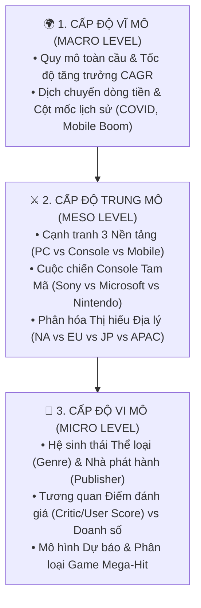
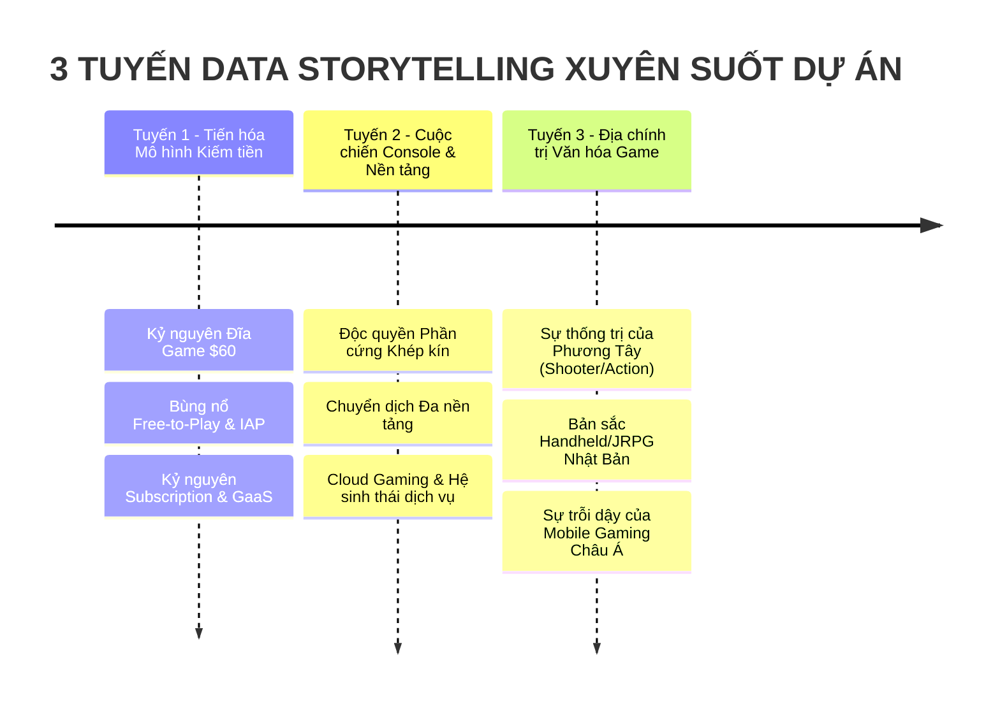

# KẾ HOẠCH PHƯƠNG HƯỚNG NGHIÊN CỨU & PHÂN TÍCH CHUYÊN SÂU
### (ADVANCED RESEARCH & ANALYTICAL FRAMEWORK)

**Môn học:** Tương tác Dữ liệu Trực quan (Interactive Data Visualization)  
**Đề tài:** Phân Tích Doanh Số & Cạnh Tranh Nền Tảng Ngành Công Nghiệp Game Toàn Cầu (PC vs Console vs Mobile)  
**Mục tiêu:** Cung cấp khung phương pháp luận nghiên cứu, 5 trụ cột phân tích chuyên sâu, hệ thống giả thuyết khoa học và 3 tuyến kể chuyện dữ liệu (Data Storytelling) đạt chuẩn học thuật Senior Data Analyst.

---

## 🧭 I. KHUNG PHƯƠNG PHÁP LUẬN NGHIÊN CỨU (RESEARCH METHODOLOGY)

Đồ án tiếp cận bài toán theo mô hình **Phân tích Phễu 3 Cấp độ (Top-Down Funnel Analytics)**:

---

## 🏛️ II. 5 TRỤ CỘT PHÂN TÍCH CHUYÊN SÂU (5 ANALYTICAL PILLARS)

---

### 📌 TRỤ CỘT 1: Động Thái Vĩ Mô & Chu Kỳ Tăng Trưởng (Temporal & Macro Dynamics)
* **Câu hỏi cốt lõi:** Ngành game đã tăng trưởng như thế nào qua các chu kỳ kinh tế và công nghệ?
* **Phương hướng phân tích:**
  1. **Tốc độ Tăng trưởng Hàng năm (YoY) & CAGR:** Đo lường tốc độ tăng trưởng doanh thu toàn ngành từ kỷ nguyên 8-bit (1980s) đến kỷ nguyên 4K/VR (2025).
  2. **Phân tích 4 Cột mốc Lịch sử (Historical Era Milestones):**
     * *Kỷ nguyên Vàng Console (1995–2005):* PS1, PS2, N64 định hình thị trường đĩa game vật lý.
     * *Cú hích Smartphone & F2P (2012–2019):* Sự bùng nổ của iOS/Android biến game từ thú vui ngách thành ngành giải trí đại chúng lớn nhất thế giới.
     * *Cú hích Đại dịch COVID-19 (2020–2021):* Lệnh phong tỏa tạo ra đỉnh tăng trưởng đột biến (Surge Peak).
     * *Giai đoạn Tái cấu trúc & Hậu suy thoái (2022–2025):* Thị trường hạ nhiệt, làn sóng sa thải studio và sự chuyển hướng sang tối ưu chi phí phát triển.

---

### 📌 TRỤ CỘT 2: Cuộc Chiến Nền Tảng & Kinh Tế Học Nền Tảng (Platform Wars & Economics)
* **Câu hỏi cốt lõi:** Làm thế nào 3 nền tảng PC, Console, Mobile cùng tồn tại và cạnh tranh giành giật thời gian của người chơi?
* **Phương hướng phân tích:**
  1. **Sự Dịch chuyển Miếng bánh Thị phần (Market Share cannibalization vs Expansion):**
     * Chứng minh Mobile không chỉ "cướp" thị phần mà còn mở rộng tổng quy mô tệp khách hàng (Non-gamers $\rightarrow$ Casual Gamers).
     * Tính ổn định và khả năng giữ chân người chơi trung thành (Hardcore Gamers) của PC và Console.
  2. **Cuộc chiến Tam Mã Console (Sony vs Microsoft vs Nintendo):**
     * So sánh thị phần tích lũy qua từng thế hệ máy:
       * *Gen 6 (2000–2005):* PS2 thống trị tuyệt đối ($>155M$ máy).
       * *Gen 7 (2005–2012):* Wii tạo đột phá cảm ứng chuyển động, Xbox 360 bám đuổi sát nút PS3.
       * *Gen 8 (2013–2020):* PS4 áp đảo Xbox One; Nintendo Switch ra mắt tạo nên cơn sốt Handheld Hybrid.
       * *Gen 9 (2020–2025):* PS5 vs Xbox Series X/S và cuộc chiến thâu tóm Studio (Microsoft mua Activision Blizzard).
  3. **Mô hình Kinh doanh (Monetization Models):**
     * *Console:* Mô hình "Lưỡi dao cạo" (Bán phần cứng hòa vốn/lỗ nhẹ $\rightarrow$ Thu phí bản quyền 30% từ game và đĩa $70).
     * *Mobile:* Mô hình Free-to-Play (F2P), In-App Purchases (Gacha, Skins) và Quảng cáo.
     * *PC:* Nền tảng phân phối số (Steam), Game-as-a-Service (GaaS), MMO và Esports.

---

### 📌 TRỤ CỘT 3: Phân Rã Không Gian & Thị Hiếu Vùng Miền (Geographical & Cultural Dynamics)
* **Câu hỏi cốt lõi:** Bản sắc văn hóa và cơ sở hạ tầng công nghệ ảnh hưởng thế nào đến hành vi tiêu dùng game tại từng khu vực?
* **Phương hướng phân tích:**
  1. **Bắc Mỹ (North America - NA):**
     * *Đặc trưng:* Thị trường doanh thu trên mỗi người chơi (ARPU) cao nhất.
     * *Thị hiếu:* Thống trị bởi thể loại **Action, Shooter (FPS), Sports** (Call of Duty, Madden NFL, GTA).
     * *Nền tảng:* Cạnh tranh khốc liệt giữa PlayStation và Xbox.
  2. **Châu Âu (Europe - EU):**
     * *Đặc trưng:* Thị trường chuộng bóng đá và mô phỏng (FIFA/EA Sports FC thống trị tuyệt đối).
     * *Nền tảng:* Nghiêng mạnh về PlayStation và PC Gaming.
  3. **Nhật Bản (Japan - JP):**
     * *Đặc trưng:* Văn hóa chơi game di động khi đi tàu điện (Commuting culture) và lòng trung thành nội địa.
     * *Thị hiếu:* Thống trị bởi **JRPG, Turn-based Strategy, Anime/Gacha** (Pokemon, Dragon Quest, Final Fantasy).
     * *Nền tảng:* Nintendo và Handheld thống trị (Switch/3DS), Xbox gần như không có thị phần đáng kể.
  4. **Phần còn lại & APAC (Rest of World / Emerging Markets):**
     * *Đặc trưng:* Động lực tăng trưởng số lượng người chơi nhanh nhất thế giới.
     * *Thị hiếu:* Thống trị bởi **Mobile Gaming & Free-to-Play Esports** (PUBG Mobile, Mobile Legends, Free Fire, LoL).

---

### 📌 TRỤ CỘT 4: Hệ Sinh Thái Thể Loại, Nhà Phát Hành & Động Lực Chất Lượng (Genre & Publisher Ecosystem)
* **Câu hỏi cốt lõi:** Yếu tố nào (thể loại, thương hiệu nhà phát hành hay điểm số chuyên gia) quyết định thành công thương mại của tựa game?
* **Phương hướng phân tích:**
  1. **Ma trận Thể loại vs Nền tảng (Genre Dominance Matrix):**
     * Xác định "DNA thể loại" của từng nền tảng (ví dụ: Strategy/MOBA thuộc về PC; Shooter/Racing thuộc về Console; Casual/Puzzle thuộc về Mobile).
  2. **Mức độ Tập trung Thị phần của Top Publishers (Publisher Concentration):**
     * Tính toán chỉ số tập trung thị trường (Top 5 / Top 10 Publishers chiếm bao nhiêu % doanh thu toàn cầu).
     * So sánh chiến lược của *Nhà phát triển Độc quyền (First-party: Sony Interactive, Nintendo)* vs *Nhà phát hành Đa nền tảng (Third-party: EA, Ubisoft, Activision, Take-Two)*.
  3. **Tương quan Điểm Đánh giá vs Doanh Số (Quality vs Commercial Success):**
     * Khám phá mối quan hệ giữa **Critic Score** (Điểm chuyên gia Metacritic), **User Score** (Điểm cộng đồng) và **Global Sales**.
     * Phân tích các trường hợp ngoại lệ:
       * *Hiện tượng "Flop Hàn Lâm":* Game điểm cao chót vót ($>90$) nhưng kén người chơi, doanh số thấp.
       * *Hiện tượng "In Tiền Đại Chúng":* Game điểm đánh giá trung bình ($60–75$) nhưng doanh số hàng chục triệu bản nhờ thương hiệu mạnh hoặc marketing tốt (ví dụ: các bản FIFA/Call of Duty hàng năm).

---

### 📌 TRỤ CỘT 5: Dự Báo Thống Kê & Phân Loại Thành Công (Predictive & Prescriptive Modeling)
* **Câu hỏi cốt lõi:** Tương lai ngành game sẽ đi về đâu và làm sao để tối ưu hóa xác suất thành công cho một dự án game mới?
* **Phương hướng phân tích:**
  1. **Mô hình Hồi quy Tuyến tính (Linear Regression - Forecasting 2026–2030):**
     * Dự báo xu hướng doanh thu và thị phần từng nền tảng với khoảng tin cậy 95% ($CI$).
     * Đánh giá chất lượng mô hình qua $R^2$, RMSE, MAE.
  2. **Mô hình Hồi quy Logistic (Logistic Regression - Hit Game Classifier):**
     * Biến mục tiêu ($Y$): `Is_Hit` ($1$ nếu doanh số $\ge 1.0M$ bản, ngược lại $0$).
     * Các biến giải thích ($X$): Thể loại, Nền tảng, Hãng phát hành lớn (First-party/Top Publisher), Điểm Critic Score, Game đa nền tảng (Is_CrossPlatform).
     * Trích xuất trọng số hệ số hồi quy ($\beta_i$) và Tỷ số Chênh (Odds Ratio) để trả lời: *"Tăng 10 điểm Critic Score thì xác suất trở thành Hit Game tăng bao nhiêu lần?"*

---

## 🧪 III. HỆ THỐNG GIẢ THUYẾT NGHIÊN CỨU (RESEARCH HYPOTHESES)

Trong quá trình phân tích và viết báo cáo khoa học IEEE, nhóm sẽ lần lượt kiểm định 4 giả thuyết chính:

*   **Giả thuyết $H_1$ (Sự dịch chuyển Nền tảng):** *Sự bùng nổ của Mobile Gaming làm giảm thị phần tương đối (%) của PC và Console, nhưng không làm suy giảm quy mô doanh thu tuyệt đối ($) của hai nền tảng này.*
*   **Giả thuyết $H_2$ (Động lực Chất lượng):** *Điểm đánh giá của chuyên gia (Critic Score) có tương quan thuận với doanh số bán hàng mạnh hơn và có ý nghĩa thống kê cao hơn so với điểm đánh giá của cộng đồng (User Score).*
*   **Giả thuyết $H_3$ (Tính Dị biệt Thị trường Nhật Bản):** *Thị trường Nhật Bản có tỷ trọng tiêu thụ game RPG và game trên hệ máy Nintendo cao hơn đáng kể có ý nghĩa thống kê so với thị trường Bắc Mỹ và Châu Âu.*
*   **Giả thuyết $H_4$ (Lợi thế Độc quyền vs Đa nền tảng):** *Các tựa game phát hành đa nền tảng (Cross-platform) có tổng doanh thu trung bình cao hơn nhưng xác suất đạt điểm Critic Score xuất sắc ($\ge 90$) thấp hơn các tựa game phát hành độc quyền (Exclusive).*

---

## 📖 IV. 3 TUYẾN KỂ CHUYỆN DỮ LIỆU (DATA STORYTELLING FRAMEWORK)

3 tuyến câu chuyện này sẽ xuyên suốt từ Dashboard đến Báo cáo IEEE và Bài thuyết trình:

1. **Storyline 1 — "The Great Monetization Shift" (Cuộc Đại Di Cư Mô Hình Kiếm Tiền):**
   * Khắc họa hành trình từ lúc người chơi trả $50–$60 để sở hữu trọn đời 1 đĩa game sang thời kỳ người chơi tải game miễn phí nhưng chi hàng trăm USD cho skin, vật phẩm ảo và Battle Pass.
2. **Storyline 2 — "The Platform Paradox: Hardware vs Ecosystem" (Nghịch Lý Nền Tảng):**
   * Phân tích sự chuyển dịch từ việc cạnh tranh bằng số lượng máy bán ra (Hardware Units) sang cạnh tranh bằng số lượng người dùng hoạt động hàng tháng (MAU) và dịch vụ thuê bao (Game Pass / PS Plus).
3. **Storyline 3 — "Cultural Geopolitics of Play" (Địa Chính Trị Văn Hóa Trong Trò Chơi):**
   * Lý giải tại sao một tựa game có thể là "bom tấn" ở Mỹ nhưng lại "vô danh" ở Nhật Bản và ngược lại, từ đó rút ra bài học bản địa hóa (Localization) cho các nhà phát triển game toàn cầu.

---

## 📏 V. DANH MỤC CHỈ SỐ ĐỊNH LƯỢNG (METRICS & KPI CATALOG)

| Chỉ số / Công thức | Ý nghĩa Nghiên cứu |
| :--- | :--- |
| **CAGR (Compound Annual Growth Rate)** | $CAGR = \left(\frac{Revenue_{end}}{Revenue_{start}}\right)^{\frac{1}{n}} - 1$: Tốc độ tăng trưởng kép hàng năm của từng nền tảng |
| **Market Share %** | $MS_{i,t} = \frac{Revenue_{i,t}}{\sum Revenue_t} \times 100\%$: Tỷ trọng doanh thu nền tảng/thể loại $i$ ở năm $t$ |
| **Publisher Concentration Ratio ($CR_{10}$)** | $CR_{10} = \sum_{k=1}^{10} MS_k$: Mức độ chi phối thị trường của Top 10 Publishers hàng đầu |
| **Regional Preference Index ($RPI$)** | Đo lường mức độ thiên vị của một khu vực đối với một thể loại/nền tảng so với mức trung bình toàn cầu |
| **Odds Ratio ($OR$) trong Logistic Reg** | $OR = e^{\beta_j}$: Mức độ tăng xác suất trở thành Hit Game khi một đặc tính (Genre, Platform, Critic Score) thay đổi 1 đơn vị |
