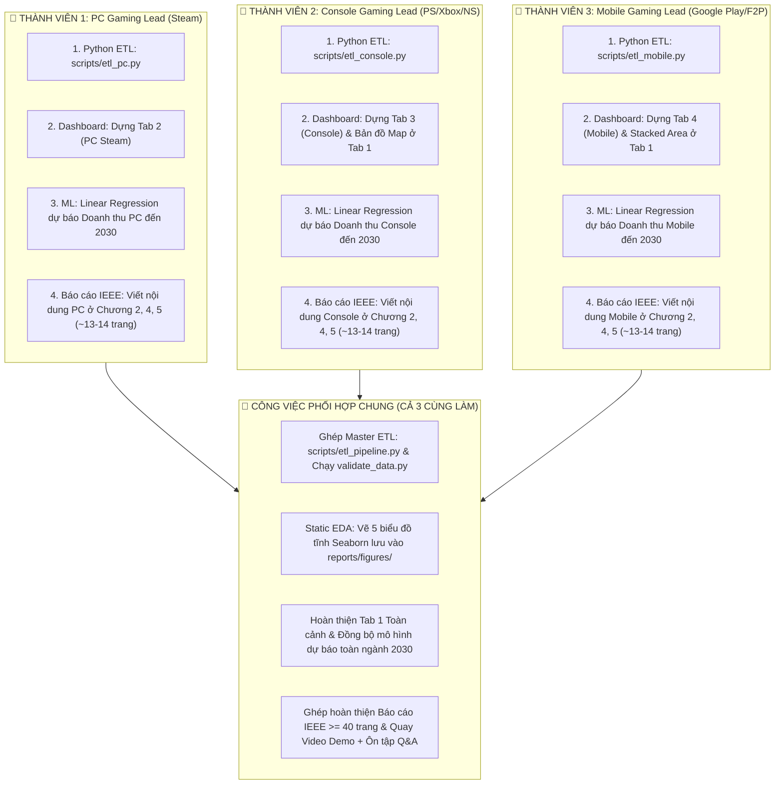

# BẢN PHÂN CHIA CÔNG VIỆC NHÓM 3 NGƯỜI (TEAM WORK BREAKDOWN STRUCTURE)
## MÔ HÌNH TRỤC DỌC NỀN TẢNG (VERTICAL DOMAIN SLICING - AI CŨNG LÀM ĐỦ 4 KHÂU)

* **Đồ án:** Phân Tích Doanh Số & Cạnh Tranh Nền Tảng Ngành Công Nghiệp Game Toàn Cầu  
* **Môn học:** Tương tác Dữ liệu Trực quan (Interactive Data Visualization)  
* **Nguyên tắc phân chia cốt lõi:**
  1. **Khối lượng công việc cân bằng tuyệt đối (~33.3% mỗi người)**.
  2. **Tránh bẫy "nghẽn tuần tự":** Cả 3 thành viên lập trình và xây dựng sản phẩm song song ngay từ Ngày 1.
  3. **Chống trừ điểm vấn đáp chéo:** Cả 3 người đều tự tay làm đủ cả 4 kỹ năng: **Python ETL $\rightarrow$ Dashboard Power BI/Tableau $\rightarrow$ ML Linear Regression $\rightarrow$ Viết Báo cáo IEEE**.

---

## 👥 I. MA TRẬN PHÂN CÔNG THEO 3 NỀN TẢNG (PC — CONSOLE — MOBILE)

---

## 📋 II. BẢNG ĐỐI CHIẾU TRÁCH NHIỆM CHI TIẾT

| Hạng mục công việc | 👤 Thành viên 1 (PC Lead) | 👤 Thành viên 2 (Console Lead) | 👤 Thành viên 3 (Mobile Lead) |
|---|---|---|---|
| **1. Python Data Engineering (ETL)** | • Viết `scripts/etl_pc.py` • Tính Midpoint Owners từ dải chuỗi • Tính Doanh thu Net sau Discount • Chuẩn hóa Rating từ % Positive | • Viết `scripts/etl_console.py` • Xử lý Shipped units sang số nguyên • Tính Doanh thu theo MSRP Era (\$50/\$60/\$70) • Nạp dữ liệu địa lý 2021–2025 | • Viết `scripts/etl_mobile.py` • Xử lý realInstalls • Tính ARPU hiệu chỉnh từ file Genre • Chuẩn hóa Rating từ 0-5 sao sang 0-100 |
| *(Phần ETL chung)* | *(Cả 3 cùng tích hợp vào `scripts/etl_pipeline.py` để xuất Master Clean Dataset và kiểm thử `validate_data.py`)* | | |
| **2. Thiết kế Dashboard** | • **Dựng TAB 2: Nền tảng PC (Steam)** • Cấu hình biểu đồ đối đầu: **Highlight Xanh Steam** • Biểu đồ tương quan Giá bán vs Owners • Đóng góp KPI & Genre PC vào Tab 1 | • **Dựng TAB 3: Nền tảng Console** • Cấu hình biểu đồ đối đầu: **Highlight Đỏ/Tím** • Biểu đồ Tam Mã (PS vs Xbox vs NS) • **Dựng Bản đồ Địa lý 2021–2025 ở Tab 1** | • **Dựng TAB 4: Nền tảng Mobile** • Cấu hình biểu đồ đối đầu: **Highlight Xanh Android** • Biểu đồ Nghịch lý Lượt tải vs IAP • **Dựng Biểu đồ Thị phần 100% Stacked Area ở Tab 1** |
| **3. Mô hình Hồi quy (ML)** | • Chạy Hồi quy Tuyến tính dự phóng **Doanh thu PC** đến 2030 (kèm 95% Confidence Band, $R^2$, RMSE) | • Chạy Hồi quy Tuyến tính dự phóng **Doanh thu Console** đến 2030 (kèm 95% Confidence Band, $R^2$, RMSE) | • Chạy Hồi quy Tuyến tính dự phóng **Doanh thu Mobile** đến 2030 (kèm 95% Confidence Band, $R^2$, RMSE) |
| *(Phần ML chung)* | *(Cả 3 cùng tích hợp 3 đường dự báo thành Biểu đồ Xu hướng Toàn ngành 2026–2030 trên Tab 1)* | | |
| **4. Báo cáo IEEE ($\ge 40$ trang)** | • Viết nội dung PC ở Chương 2, 4, 5 (~13 trang) • Viết Mở đầu & Giới thiệu đề tài (Chương 1) | • Viết nội dung Console ở Chương 2, 4, 5 (~13 trang) • Viết Kiến trúc & Thiết kế Dashboard (Chương 3) | • Viết nội dung Mobile ở Chương 2, 4, 5 (~13 trang) • Viết Hướng dẫn sử dụng (Chương 6) & Kết luận (Chương 7) |
| *(Phối hợp Báo cáo & QA)* | *(Cả 3 cùng đọc phản biện chéo bài của nhau, quay Video Demo sản phẩm, và ôn luyện bộ tài liệu phản biện `docs/qa_defense_prep.md`)* | | |

---

## ⏱️ III. LỘ TRÌNH 4 MỐC PHỐI HỢP ĐỒNG BỘ (SYNC POINTS)

*   **Mốc 1 (Ngày 1–2) — Khởi động song song:**
    *   Thành viên 1 code `etl_pc.py`.
    *   Thành viên 2 code `etl_console.py`.
    *   Thành viên 3 code `etl_mobile.py`.
    *   Dựng khung 4 Tab Dashboard bằng dữ liệu mẫu ban đầu.
*   **Mốc 2 (Ngày 3–4) — Khớp nối dữ liệu thật:**
    *   Chạy `etl_pipeline.py` xuất ra `master_gaming_industry_clean.csv` và `regional_sales_geo.csv`.
    *   Kiểm thử bằng `validate_data.py` (đảm bảo $\ge 10.000$ dòng và sạch 100%).
    *   Nạp số thật vào Dashboard $\rightarrow$ Hoàn thiện các biểu đồ và tính năng tương tác.
*   **Mốc 3 (Ngày 5–6) — Modeling & Khai phá Insight:**
    *   Mỗi người chạy mô hình Linear Regression cho nền tảng của mình $\rightarrow$ Đưa kết quả vào Tab 1.
    *   Viết các chương Báo cáo IEEE tương ứng với nền tảng phụ trách.
*   **Mốc 4 (Ngày 7) — Đóng gói & Tập dượt Vấn đáp:**
    *   Ghép thành 1 file Báo cáo IEEE duy nhất $\ge 40$ trang.
    *   Quay Video Demo backup chất lượng cao.
    *   Tổ chức họp nhóm chất vấn thử dựa trên bộ câu hỏi `docs/qa_defense_prep.md`.
