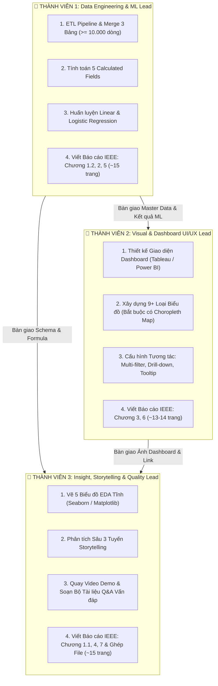

# BẢN PHÂN CHIA CÔNG VIỆC NHÓM 3 NGƯỜI (TEAM WORK BREAKDOWN STRUCTURE)

**Đồ án:** Phân Tích Doanh Số & Cạnh Tranh Nền Tảng Ngành Công Nghiệp Game Toàn Cầu  
**Môn học:** Tương tác Dữ liệu Trực quan  
**Nguyên tắc phân chia:** Đảm bảo khối lượng cân bằng (**~33% mỗi người**), chuyên môn hóa theo năng lực, độc lập tiến độ và phân chia rõ ràng từng chương trong Báo cáo IEEE $\ge 40$ trang.

---

## 👥 I. MA TRẬN PHÂN CÔNG TỔNG THỂ

---

## 📋 II. CHI TIẾT NHIỆM VỤ TỪNG THÀNH VIÊN

---

### 👤 THÀNH VIÊN 1: Data Engineering & Machine Learning Lead
*   **Trọng tâm:** Xử lý dữ liệu gốc, tính toán 5 chỉ số và xây dựng mô hình dự báo toán học.
*   **Nhiệm vụ Kỹ thuật & Thực hành:**
    1. Viết script ETL Python nạp 3 dataset raw (Console/VGChartz, PC/Steam, Mobile/Google Play) $\rightarrow$ Merge thành **Master Clean Dataset $\ge 10.000$ dòng**.
    2. Tính toán **5 Calculated Fields** bắt buộc (`Harmonized_Revenue_USD`, `Market_Share_Pct`, `Era_Milestone`, `Rating_Class`, `Is_CrossPlatform`).
    3. Huấn luyện mô hình **Linear Regression** (dự báo doanh số/thị phần 2026–2030 kèm dải tin cậy 95%, $R^2$, RMSE, MAE).
    4. Huấn luyện mô hình **Logistic Regression** (dự đoán xác suất Hit Game $\ge 1M$ bản, xuất ROC-AUC, Confusion Matrix).
    5. Xuất bảng dữ liệu kết quả dự báo bàn giao cho Thành viên 2 đưa lên Dashboard.
*   **Phần viết Báo cáo IEEE (~15 trang):**
    *   *Chương 1 (Mục 1.2):* Nguồn gốc dữ liệu & Bảng Data Dictionary chi tiết (~3 trang).
    *   *Chương 2:* Quy trình Tiền xử lý, Xử lý missing/outlier & Công thức 5 Calculated Fields (~6 trang).
    *   *Chương 5:* Cơ sở toán học, Quy trình huấn luyện và Đánh giá 2 Mô hình ML (~6 trang).
*   **Trách nhiệm khi Vấn đáp:** Giải thích lưu loát các bước làm sạch dữ liệu, công thức tính toán và ý nghĩa thống kê của các chỉ số mô hình ($R^2$, RMSE, ROC-AUC).

---

### 👤 THÀNH VIÊN 2: Visual Analytics & Dashboard UI/UX Lead
*   **Trọng tâm:** Thiết kế giao diện tương tác, trực quan hóa 9+ loại biểu đồ trên Tableau / Power BI.
*   **Nhiệm vụ Kỹ thuật & Thực hành:**
    1. Thiết kế bố cục Dashboard 4 màn hình / Story Points khoa học và thẩm mỹ.
    2. Xây dựng **9+ loại biểu đồ** theo chuẩn Barem:
       - 🗺️ **Choropleth Map** (Bản đồ thế giới - bắt buộc).
       - 🌊 **100% Stacked Area**, 📊 **Grouped Bar**, 📈 **Multi-line**, 🫧 **Bubble Plot**, 🌡️ **Heatmap**, 🍩 **Sunburst/Donut**, 📦 **Boxplot**, 🗂️ **Treemap**, 🔮 **Forecast Chart**.
    3. Cấu hình các tính năng tương tác chuyên sâu:
       - Bộ lọc đa chiều (Năm, Nền tảng, Thể loại, Vùng miền).
       - Tính năng *Drill-down* (Từ Console $\rightarrow$ Hãng máy Sony/Microsoft/Nintendo $\rightarrow$ Tựa game).
       - Tính năng *Cross-filtering* và *Custom Tooltip*.
    4. Tích hợp Tab Dự báo từ kết quả ML mà Thành viên 1 bàn giao.
*   **Phần viết Báo cáo IEEE (~13 – 14 trang):**
    *   *Chương 3:* Thiết kế Kiến trúc Dashboard, UX/UI & Lý thuyết lựa chọn 9+ loại biểu đồ (~8 trang).
    *   *Chương 6:* Hướng dẫn Sử dụng Dashboard & Kịch bản Tương tác chi tiết (~5 trang).
*   **Trách nhiệm khi Vấn đáp:** Nắm vững nguyên lý trực quan hóa, lý do lựa chọn từng loại biểu đồ và thao tác demo trực tiếp mượt mà trước hội đồng.

---

### 👤 THÀNH VIÊN 3: Business Analytics, Storytelling & Quality Control Lead
*   **Trọng tâm:** Phân tích Insight chuyên sâu, kể chuyện dữ liệu, video demo và đảm bảo chất lượng toàn bộ đồ án.
*   **Nhiệm vụ Kỹ thuật & Thực hành:**
    1. Vẽ và phân tích **5 biểu đồ EDA tĩnh** (Seaborn/Matplotlib) trong giai đoạn khám phá dữ liệu ban đầu.
    2. Khai phá Insight chuyên sâu cho **3 Tuyến Storytelling**:
       - *Tuyến 1:* Sự dịch chuyển thị phần từ Console sang Mobile và sự ổn định của PC.
       - *Tuyến 2:* Tiến hóa mô hình kinh doanh (từ B2P sang F2P, IAP, Subscription).
       - *Tuyến 3:* Phân rã thị hiếu địa lý (Bắc Mỹ, Nhật Bản, Châu Âu, Châu Á).
    3. Quay **Video Demo backup** sản phẩm & Soạn kịch bản thuyết trình (Script).
    4. Soạn **Bộ câu hỏi Q&A Vấn đáp nội bộ** (tổng hợp các câu hỏi thầy cô hay xoáy để cả 3 người cùng ôn tập).
    5. Chủ trì ghép và chuẩn hóa format Báo cáo IEEE ($\ge 40$ trang) thành 1 file hoàn chỉnh.
*   **Phần viết Báo cáo IEEE (~15 trang):**
    *   *Chương 1 (Mục 1.1):* Bối cảnh ngành game & Chi tiết 5 Câu hỏi Nghiên cứu (~3 trang).
    *   *Chương 4:* Khai phá Insight Chuyên sâu (3 Tuyến Storytelling) (~8 trang).
    *   *Chương 7:* Kết luận, Hạn chế dữ liệu, Hướng phát triển & Danh mục tài liệu tham khảo IEEE (~4 trang).
*   **Trách nhiệm khi Vấn đáp:** Trình bày bức tranh toàn cảnh thị trường, liên hệ thực tế ngành game và trả lời các câu hỏi về giá trị ứng dụng/hạn chế của đề tài.

---

## 📑 III. BẢNG PHÂN CHIA VIẾT BÁO CÁO IEEE ($\ge 40$ TRANG)

| Thành viên | Chương phụ trách | Nội dung chi tiết | Trang dự kiến |
| :---: | :--- | :--- | :---: |
| **👤 TV1** | **Chương 1 (1.2)** | Data Dictionary & Nguồn gốc dữ liệu | ~3 trang |
| | **Chương 2** | Quy trình Tiền xử lý & 5 Calculated Fields | ~6 trang |
| | **Chương 5** | Cơ sở toán học & Đánh giá mô hình ML | ~6 trang |
| **👤 TV2** | **Chương 3** | Kiến trúc Dashboard & Lý do chọn 9+ biểu đồ | ~8 trang |
| | **Chương 6** | Hướng dẫn sử dụng & Kịch bản tương tác | ~5 trang |
| **👤 TV3** | **Chương 1 (1.1)** | Bối cảnh & 5 Câu hỏi nghiên cứu | ~3 trang |
| | **Chương 4** | Khai phá Insight chuyên sâu (3 Tuyến Storytelling) | ~8 trang |
| | **Chương 7** | Kết luận, Hạn chế & Tài liệu tham khảo IEEE | ~4 trang |
| **TỔNG CỘNG** | **7 Chương Bắt Buộc** | **Đầy đủ công thức, bảng biểu và ảnh chụp** | **~43 trang** |

---

## ⏱️ IV. MA TRẬN PHỐI HỢP & BÀN GIAO THEO TUẦN

| Tuần | 👤 Thành viên 1 (Data & ML) | 👤 Thành viên 2 (Dashboard) | 👤 Thành viên 3 (Insight & Report) |
| :---: | :--- | :--- | :--- |
| **Tuần 1** | Viết ETL, gộp 3 bảng $\ge 10k$ dòng, tính 5 Calculated Fields $\rightarrow$ **Bàn giao Master Data** | Dựng khung Layout Dashboard, chọn bảng màu, tạo cấu trúc 4 màn hình | Vẽ 5 biểu đồ EDA tĩnh (Seaborn), lập Data Dictionary, dựng khung Báo cáo |
| **Tuần 2** | Huấn luyện Linear & Logistic Regression $\rightarrow$ **Bàn giao Bảng Dự báo ML** | Nạp Master Data, vẽ 6 biểu đồ đầu tiên (có Choropleth Map) | Phân tích 3 tuyến Storytelling, viết **Chương 4** Báo cáo |
| **Tuần 3** | Viết **Chương 1.2, 2, 5** Báo cáo IEEE | Hoàn thiện 9+ biểu đồ, cấu hình Drill-down & Tab Dự báo $\rightarrow$ **Bàn giao ảnh chụp** | Viết **Chương 1.1, 7**, soạn kịch bản demo thuyết trình |
| **Tuần 4** | Rà soát công thức toán và code logic | Viết **Chương 3, 6** Báo cáo IEEE | Ghép hoàn chỉnh **Báo cáo IEEE $\ge 40$ trang**, quay Video Demo, chủ trì ôn tập Q&A |
